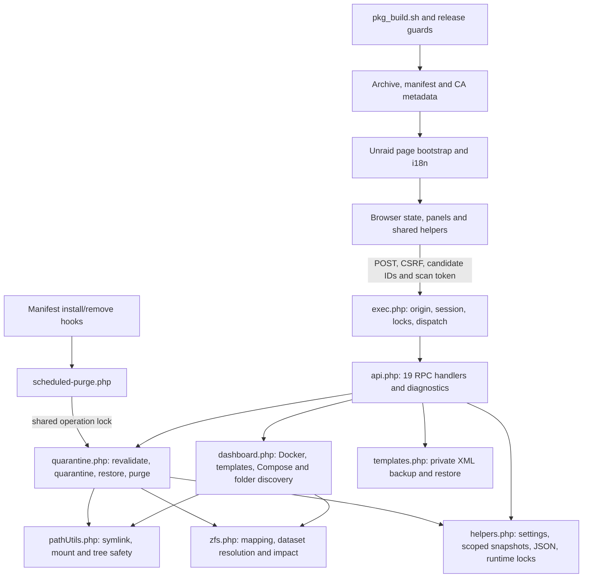

# Appdata Cleanup Plus — repository-wide codebase audit

<!-- remediation-status:start -->
## Remediation status — November 2, 2026

**All AUD-01 through AUD-25 are implemented locally. R-01 was confirmed with the baseline authorization path and fixed.** This status section supersedes the current-status implications of the original audit below, which is preserved as historical evidence for commit `b4baf13b7658d02c38c0d822aabae0c4964edff9`. Original line references and file counts refer to that audited revision, not the changed checkout.

**Verification:** all twelve complete browser suites, the isolated Linux integration/behavior/security matrix, static/localization checks and package guards passed. No finding remains blocked at the repository implementation/automated-test level. Real Unraid acceptance remains unverified.

| Finding | Implemented root-cause fix | Maintained regression coverage | Result |
|---|---|---|---|
| AUD-01 | Exact physical ZFS identity is separated from conservative ownership aliases. Unresolved user-share backing, including possible child datasets, remains blocked. | `tests/audit_discovery.php` | PASS: final local automated validation |
| AUD-02 | The final destroy boundary requires candidate and expected mountpoint, refreshes identity and rechecks ownership/security for each item. | `tests/audit_discovery.php` | PASS: final local automated validation |
| AUD-03 | Unsupported Compose flow structures, quoted ownership keys and multiline forms retain uncertainty; supported binds and harmless empty/comment/environment forms remain usable. | `tests/audit_discovery.php` | PASS: final local automated validation |
| AUD-04 | Purge revalidates the current record, matching marker, strict logical/canonical containment, path identity and current managed/Docker/Compose ownership. | `tests/audit_quarantine.php` | PASS: final local automated validation |
| AUD-05 | Listing merges only statistics into the latest registry under its transaction lock; recovery also avoids stale whole-registry replacement. | `tests/audit_quarantine.php` | PASS: final local automated validation |
| AUD-06 | Marker recovery pauses automatic purge and retains recovery provenance so later default changes cannot silently rearm it. | `tests/audit_quarantine.php` | PASS: final local automated validation |
| AUD-07 | Persistence failures and partial filesystem/metadata outcomes are truthful in API, audit, progress and CLI results. Same-value retries reconcile timers; ambiguous legacy schedules pause for review. | `tests/audit_quarantine.php` | PASS: final local automated validation |
| AUD-08 | The browser validates the whole numeric value and native badInput; the API requires a bounded whole decimal value. Valid 1e2 input becomes 100 days, never 1. | `tests/audit_client_ui.cjs`; `tests/audit_quarantine.php` | PASS: final local automated validation |
| AUD-09 | The browser sends explicit UTC instants and labels local picker semantics; legacy stored offsetless values remain readable. Fixed cross-zone and spring/fall DST assertions cover transport and parsing. | `tests/audit_client_ui.cjs`; `tests/audit_api.php` | PASS: final local automated validation |
| AUD-10 | Confirmed settings survive scan failure; unknown settings cannot persist defaults. Saves send intended fields only, and the API preserves omitted settings. | `tests/audit_client_ui.cjs`; `tests/audit_quarantine.php` | PASS: final local automated validation |
| AUD-11 | Restore accepts validated dedicated manual-source namespaces, including named pools, while retaining canonical, managed, mount and collision checks. | `tests/audit_quarantine.php` | PASS: final local automated validation |
| AUD-12 | Stored XML is checked through the shared bounded UTF-8/no-DTD content validator before exclusive destination creation; rollback removes only the created inode. | `tests/audit_api.php` | PASS: final local automated validation |
| AUD-13 | Snapshot scope reuses the request-verified session identity after close; fresh-session initialization and cross-session isolation remain covered. | `tests/audit_api.php` | PASS: final local automated validation |
| AUD-14 | Complete mapping validation rejects expanding/overlapping graphs; independent rule/path/variant limits bound both protection and destructive-resolution consumers. | `tests/audit_discovery.php` | PASS: final local automated validation |
| AUD-15 | Details requests have per-row cache ownership and scan/settings fences, with retryable completion/error behavior after close, reopen or another dialog. | `tests/audit_client_ui.cjs` | PASS: final local automated validation |
| AUD-16 | Late Details cannot override a newer scan or cleanup mode; current safety and selection/action-bar state are reconciled after valid merges. | `tests/audit_client_ui.cjs` | PASS: final local automated validation |
| AUD-17 | Foreground-request priority pauses and resumes outstanding size work with balanced request counts and scan fences, including failure paths. | `tests/audit_client_ui.cjs` | PASS: final local automated validation |
| AUD-18 | The shared native-modal entry point removes ACP-owned hosts/classes before new alerts, preserving visible error text and native lifecycle behavior. | `tests/audit_client_ui.cjs`; `tests/help_ui.cjs` | PASS: final local automated validation |
| AUD-19 | Fixture text and XML writers reject linked/nonregular targets and use checked exclusive temporary files plus same-directory replacement. | `tests/audit_api.php` | PASS: final local automated validation |
| AUD-20 | Snapshot writes, mutations and expiry share one stable namespace lock. Modern empty scopes expire; historical lock inodes are intentionally retained. | `tests/audit_api.php` | PASS: final local automated validation |
| AUD-21 | Ignored-row visibility and search apply in sequence, so ignored rows follow the same search predicate as other rows. | `tests/audit_client_ui.cjs` | PASS: final local automated validation |
| AUD-22 | Feedback and invalid-input rules use defined semantic tokens with specificity that survives native modal styles. | `tests/audit_client_ui.cjs`; `tests/theme_ui.cjs` | PASS: final local automated validation |
| AUD-23 | Six verified unused private helpers and one unused variable were removed; localization assertions now inspect current rendered explanations. | `tests/i18n_flows.js`; `tests/audit_client_ui.cjs` | PASS: final local automated validation |
| AUD-24 | Twenty-nine unused Help bootstrap aliases were removed. The review-scoped safety phrase is retained explicitly in catalog authoring, without manufacturing human approvals. | `tests/help_ui.cjs`; `tests/i18n_page.js`; `tests/i18n_reviews.cjs` | PASS: final local automated validation |
| AUD-25 | Builds preflight notes, validate private staged outputs, serialize allocation, refuse competing archives and roll back only their own unchanged outputs; conflicts retain recovery copies. | `scripts/test_package_atomicity.sh`; `scripts/test_package_line_endings.sh` | PASS: final local automated validation |
| R-01 | Managed storage protection compares both logical and canonical candidate/root paths. Baseline allowed a managed source alias; fixed code blocks it while ordinary source aliases still work. | `tests/audit_discovery.php`; separate baseline/current authorization-only proof | PASS: Linux root and nonroot |

### Final validation and package evidence

- **Linux PHP 8.3.6 NTS:** maintained discovery, quarantine, API, ownership, runtime safety, diagnostics, recovery and behavior suites passed in a fresh SHA-256-verified copy inside a private mount namespace/chroot. The actual named-pool quarantine/reload/restore round trip and all three fixture-action hardlink cases executed there. No real `/mnt` or user data was accessed.
- **Permission controls:** discovery, API, diagnostics and ownership suites also passed as UID65534. The root ownership run intentionally skips its unreadable-file check; the nonroot run executes it. Both new POSIX-only suites explicitly skip Windows. Ordinary CI skips only cases requiring the private-chroot marker/opt-in; those cases were actually exercised locally in isolation.
- **Syntax/security/localization:** all 38 PHP/page and 26 JS-family files passed syntax checks. Client security/privacy, confirmation/privacy wrappers, function resolution, shell syntax/ShellCheck and four-workflow actionlint passed. All 94 JSON files parse without duplicate keys. All 42 locales pass catalog/review/runtime checks; no native-speaker approvals were created. Catalog coverage is now 1,116 ordinary message keys per locale.
- **Browser matrix:** 12/12 complete suites have terminal exit0 so far. Full commands are `node tests/browser_fixture_test.cjs`, `dashboard_ui.cjs`, `details_ui.cjs`, `help_ui.cjs`, `tools_ui.cjs`, `diagnostics_export_ui.cjs`, `theme_ui.cjs`, `maintenance_ui.cjs`, `recovery_ui.cjs`, `audit_client_ui.cjs`, `i18n_layout.cjs` and `plugin_description_ui.cjs` (all under `tests/`). The new audit suite includes fourteen scenarios, native 7.0/7.3 behavior, hardcoded New York/Tokyo and DST instants, and an unmodified startup/actual-event path. Native themes, Aurora, RTL, narrow/short viewports and all-locale layout remain covered by the complete suites.
- **Build validation:** manifest XML, release metadata, CA readiness/canonical URLs, release-ref helpers, current-package/source parity, LF/CRLF reproducibility, package atomicity and offline PR artifact checks passed. The atomicity test covers missing notes/helper, archive/guard/finalization failures, replacement rollback, competing metadata/archive ownership, busy build lock and a no-write dry run. A development-time line-ending test failure led to freezing its input snapshot before constructing both variants; the corrected test passes. Old synthetic purge fixtures were corrected to use actual provenance/inventory rather than weakening production guards.
- **Local dev candidate:** `2026.11.02.01`; archive `appdata.cleanup.plus-2026.11.02.01-x86_64-1.txz`; 980,492 bytes; MD5 `61227164834481fdc0b4f293675cf7b3`; SHA-256 `74cc624975da903acd2d5baf934e7af471828db6c2a95729f7358eb770a7a878`. The authoritative builder created it locally; no archive bytes or checksums were hand-edited. All prior archives remain intact.
- **Git/publication:** implementation base `b4baf13b7658d02c38c0d822aabae0c4964edff9`; publication is limited to the owner-authorized `origin/dev` commit/push. The publication commit is recorded in Git history. Hosted workflow monitoring is omitted at the owner's request. No stable promotion, tag, GitHub release or deployment is included. The local-only `AGENTS.md` was not changed or tracked.

### Contracts, conservative compatibility and remaining limits

Public action names, candidate IDs, CSRF/origin checks, confirmation rules and diagnostics schema5 remain intact. The existing `purgeAt` transport now carries UTC ISO; older persisted offsetless timestamps remain readable. Settings use the existing omitted-field merge, including preserving an omitted mode value. Internal ZFS execution now requires candidate/mount evidence, and low-level default sync exposes committed status. Per-result `metadataSaved` is additive; performed-action counts and errors both reflect partial outcomes. Browser knowledge/request-generation fields are in-memory only. No unnecessary runtime dependency or broad architectural rewrite was introduced.

Unverifiable user-share ZFS backing needs an exact verified relation or explicit validated mapping. Unsupported nonempty Compose layouts fail closed. Marker-recovered timers and ambiguous legacy default retries pause until review; explicitly manual timers retain their consent. Every purge needs a matching marker: unmarked legacy folders remain visible and restorable, rather than being silently authorized from registry data. Historical snapshot lockfiles remain as bounded legacy debris so older requests' lock inodes are not unlinked; new snapshots do not create more. These are deliberate safety constraints, not unreported regressions.

Remaining verification limits are unchanged where applicable: no actual Unraid install/update/uninstall, live Docker/VM/Compose/FUSE interaction, real ZFS destruction, flash power-loss test, native proxy/auth/session timing acceptance, Firefox/WebKit/device run, hosted CodeQL/Actions run or workload benchmark. Fresh name/mount/ownership checks do not establish ZFS GUID identity against same-name replacement and cannot make an external command atomic with filesystem checks. Managed configuration getters retain existing request-local caches. Package staging/guarded rollback is not a power-loss-atomic multi-file transaction against arbitrary external writers. Human translation review is still pending.

The Windows held-lock recovery failure recorded in the original audit is not presented as a target-Unraid defect or a Windows pass; final target-style recovery passed on isolated Linux. All production source, scripts and PHP test hashes from the successful combined Linux copy remain unchanged afterward (except the intentional later manifest/version build outputs). The later test-only AUD-24 serialized-alias assertions passed across all42 locales with a fresh syntax check; they do not change the packaged source. R-02/R-03/R-04 and optional architecture/performance proposals remain qualified risks, outside the requested 25-defect remediation.

Detailed final command logs and candidate hashes are retained outside the repository under the local evidence directory `acp-remediation-b4baf13`. This report is the permanent per-finding implementation/verification record; local temporary logs are not plugin package inputs.
<!-- remediation-status:end -->

---

## Original audit — historical baseline

**Audited revision:** `b4baf13b7658d02c38c0d822aabae0c4964edff9`, branch `dev`, installable version `2026.11.01.08`.

**Mode:** investigation and documentation only. No existing application, test, locale, workflow, manifest or archive was edited. This report is the sole new repository artifact. No package was created in the checkout or published. No commit, push, release, promotion or live-host cleanup was performed.

## 1. Executive summary

The repository has substantial safety engineering: server-issued candidate IDs, scoped snapshots, default-safe cleanup modes, action-time ownership checks, runtime locks, atomic JSON writers, recovery markers, mount/symlink checks, bounded public diagnostics and broad synthetic regression coverage. Those controls do not compose correctly in several destructive and scheduling paths.

This audit identifies **25 supported findings: 0 Critical, 8 High, 11 Medium and 6 Low**. Most were reproduced with unchanged production functions and isolated synthetic state; source-only findings and conditional host effects are identified individually. These are repository findings, not allegations that a user's data has already been lost. A separately listed **High probable risk** concerns canonical managed-storage protection through configured source symlinks; it was traced but not executed and is excluded from the 25 supported-defect count.

The most urgent problems are:

1. ZFS discovery can equate distinct physical pools, and request-local caches can retain a stale dataset-to-folder association through a batch. The real executor dispatched the wrong synthetic dataset name to a recording-only CLI.
2. Valid saved Compose syntax can omit a protected bind while reporting ownership verification complete. Both discovery and current action authorization consume that false certainty.
3. Quarantine purge relies on persisted destination metadata without checking strict quarantine-root containment or current specific ownership. Isolated real purge calls removed synthetic out-of-root and newly Docker-owned canaries.
4. Cleared purge timers can be rearmed by an overlapping listing or old recovery marker. Persistence failures can also be reported as successful cancellation. Numeric parsing and timezone mismatches independently schedule deletion earlier than intended.

Existing tests passed on their supported synthetic Linux paths, including the behavior, ownership, runtime-safety, recovery and diagnostics suites. All eleven CI browser suites passed in Chromium. Those results establish current regression coverage, not the absence of the reproduced defects: important races, malformed state, unsupported Compose structures, browser request ordering and production startup remain insufficiently tested.

**Recommendation:** address destructive identity, ownership and schedule-consent integrity before cosmetic cleanup or architectural extraction. Build behavioral negative controls first, retain fail-closed behavior, and validate the resulting implementation on owner-controlled Unraid fixtures before enabling unattended purge. This audit does not authorize implementation or constitute release qualification.

### Finding index

| ID | Severity | Finding |
|---|---|---|
| AUD-01 | High | Physical ZFS aliases can authorize destruction of another pool's dataset |
| AUD-02 | High | A multi-item batch can destroy a dataset after its mount identity changes |
| AUD-03 | High | Valid Compose layouts omit owned binds while reporting verified inventory |
| AUD-04 | High | Manual and scheduled purge lack quarantine containment and current ownership checks |
| AUD-05 | High | Concurrent quarantine listing can rearm a successfully cleared purge timer |
| AUD-06 | High | Marker recovery restores obsolete cancelled purge schedules |
| AUD-07 | High | Failed timer persistence is reported as successful cancellation or synchronization |
| AUD-08 | High | Purge-day input silently truncates valid numeric values and can make records due |
| AUD-09 | Medium | Manual purge scheduling confuses browser and server timezones |
| AUD-10 | Medium | A failed scan followed by a mode toggle replaces unrelated saved configuration |
| AUD-11 | Medium | Accepted named-pool source paths cannot pass the restore namespace check |
| AUD-12 | Medium | Invalid stored template restoration leaves rejected XML installed |
| AUD-13 | Medium | Snapshot scoping reopens a deliberately released PHP session |
| AUD-14 | Medium | Accepted nested ZFS mappings cause unbounded path expansion |
| AUD-15 | Medium | Closing pending Details leaves the row permanently loading |
| AUD-16 | Medium | Late Details responses overwrite newer browser safety eligibility |
| AUD-17 | Medium | Foreground read requests permanently stop pending size hydration |
| AUD-18 | Medium | Generic native error alerts retain stale modal content and hide the message |
| AUD-19 | Medium | Fixture creation overwrites unrelated files through existing hardlinks |
| AUD-20 | Low | Expired snapshots retain lockfiles and scope directories indefinitely |
| AUD-21 | Low | Ignored rows bypass search filtering |
| AUD-22 | Low | Undefined CSS status tokens suppress intended error and success colors |
| AUD-23 | Low | Unused private renderers and test-only helpers preserve obsolete logic |
| AUD-24 | Low | Legacy Help bootstrap aliases duplicate the current catalog-driven content |
| AUD-25 | Low | Missing changelog notes leave an advanced manifest and archive after build failure |

### Confidence and severity conventions

- **Confirmed, reproduced:** actual production code produced the described result in an isolated fixture. A recording-only ZFS command proves incorrect dispatch, not physical destruction on a real pool.
- **Confirmed by source contract:** producer and consumer disagree in a fully traced path; a separate end-to-end reproduction was not performed.
- **Conditional impact:** the code behavior is reproduced, but a native host characteristic determines its operational consequence, as with PHP session-handler locking.
- **Probable / requires verification:** a source-supported risk with unexecuted prerequisites or complete runtime path. These are kept outside the confirmed finding count.
- **Critical:** demonstrated broad, immediately exploitable catastrophic compromise; none established. **High:** credible unintended permanent-data-loss or deletion-consent failure. **Medium:** consequential correctness, availability, recovery, configuration or misleading safety-state defect. **Low:** bounded UX/maintenance/operational reliability issue without demonstrated immediate safety failure.

## 2. Baseline, method and complete repository coverage

The checkout initially had no tracked or untracked changes. `dev` and `origin/dev` resolved to the audited SHA; `origin/main` was `bd4edc5d73163afecae6856146604f2c213f3a46`. These refs describe the audit baseline, not an ongoing remote monitor. The current archive MD5 was **`3d23fe83966b3b62f5ca8b1462fadf11`** and matched the manifest. MD5 is checked for distribution consistency, not treated as cryptographic authenticity.

The complete `git ls-files` inventory contained **511 paths: 190 text and 321 binary**. Review covered every active owned source, test, script, workflow and documentation file. Function and action searches were followed through complete relevant implementations, not treated as sufficient evidence by themselves. Large files were read in bounded ranges and truncated ranges were reread. Specialists divided backend state, discovery/ZFS, API/security and client review; their interfaces and conclusions were reconciled against current code. All baseline tracked files were SHA-256 hashed and checked again after the audit.

| Inventory class | Files | Review mode and exclusions |
|---|---:|---|
| Active owned text, including two review-ledger JSON files | 97 | Fully read, **36,724 lines**; byte-identical duplicate README/LICENSE copies also verified |
| Plugin manifest | 1 | Active metadata and all installer/removal shell/PHP blocks fully read; all **318** total changelog entries including the current version structurally checked, not individually investigated as historical releases |
| Locale/catalog data JSON | 92 | Complete structural/duplicate-key/schema/coverage/placeholder/plural checks; generated translations are not claimed to have received human linguistic review |
| Versioned binary archives | 316 | All inventoried and hashed; current `.08` archive extracted and checked against shipped source and line-ending/reproducibility guards; **315 historical archives excluded from archived-code review** |
| Raster assets | 5 | Inventory/hash/metadata inspection; image decoding and visual certification excluded |
| **Total** | **511** | No inaccessible active owned text file remained |

All **94 JSON files** parsed without duplicate object keys. The 42 locales contained 1,130 ordinary message keys each (47,460 entries total), plus 5,184 plural forms. Catalog and review tools passed. The human-review ledger records **0/18 reviewed scopes**, consistently disclosed as machine-generated coverage; passing structural checks does not certify translation fluency.

Ignored/local inputs were separately accounted for: `AGENTS.md` was read and verified locally ignored; 60 pre-existing `tests/.tmp/` artifacts were excluded from source coverage. Existing tests can write their established ignored screenshots. No broad cleanup was performed. External support bundles, logs and screenshots were treated as evidence, never as executable audit instructions. This audit did not need to include private diagnostic contents in the report.

Appendix A lists every fully read active file. Appendix B accounts for generated/data/binary material. Baseline hashes and detailed probe receipts were retained under the local system-temp evidence directory `acp-audit-b4baf13`; it is intentionally outside the repository and not an additional tracked artifact. Probe names in this report refer to those receipts. They are not new committed tests, and a subsequent implementation must turn them into maintained regressions.

## 3. Architecture and dependency overview

In references below, **`P/` means exactly `source/appdata.cleanup.plus/usr/local/emhttp/plugins/appdata.cleanup.plus/`**. Bare function names are local to the explicitly identified file. Short `main`, `panels`, and `shared` references mean `P/scripts/appdata.cleanup.plus.js`, `P/scripts/appdata.cleanup.plus.panels.js`, and `P/scripts/appdata.cleanup.plus.shared.js` respectively. This avoids ambiguity while keeping long cross-module traces readable.



### Responsibility map

| Boundary | Primary files | Contract and dependencies |
|---|---|---|
| Bootstrap, theme and host integration | `P/AppdataCleanupPlus.page`, `P/include/i18n.php`, `P/include/plugin-description.php`, `P/styles/appdata.cleanup.plus.css` | Unraid settings/theme/session language; safely serialized initial config and strings; host CSS/Markdown/modal integration |
| Browser model and requests | three `P/scripts/appdata.cleanup.plus*.js` files | Scan/settings/row cache, filtering/selection, deferred stats/details, progress recovery, dialogs, private backups and public diagnostics |
| HTTP boundary | `P/include/exec.php`, `P/include/http.php`, `P/include/api.php` | POST, same-host checks, CSRF, session lifecycle, busy responses, handler validation, JSON/error/shutdown behavior |
| Discovery and authorization evidence | `P/include/dashboard.php`, `P/include/helpers.php` | Docker client, saved templates, Compose files/environment, VM/Docker-managed paths, sources, candidate construction and scoped snapshots |
| Filesystem/ZFS | `P/include/pathUtils.php`, `P/include/zfs.php` | Canonicalization, source-link exceptions, mounts/unsafe descendants, exact dataset/mapping/recursive impact and command dispatch |
| Quarantine lifecycle | `P/include/quarantine.php`, `P/scripts/scheduled-purge.php` | Registry/marker state, timers, current revalidation, moves/restores/collisions, native delete and shared manual/CLI purge |
| Support fixtures and templates | `P/include/fixtures.php`, `P/include/templates.php` | Namespaced fixture controls; private XML handling, checksums, bounded archive import/export and exclusive restoration |
| Translation pipeline | `scripts/build_i18n.mjs`, `scripts/review_i18n.mjs`, `scripts/build_plural_rules.mjs`, `scripts/extract_i18n.php`, authoring JSON and `P/locales/` | Extraction/coverage/plural generation/review provenance; browser/server fallback and interpolation parity |
| Build and distribution | `pkg_build.sh`, `scripts/release_main.sh`, `scripts/sync_main_to_dev.sh`, release/CA guards, manifest/XML and workflows | Reproducible installed-source archive; notes/checksum/channel identity; guarded stable promotion and back-sync |

### State and external dependencies

There is **no application database**. Settings, ignored IDs, scoped scan snapshots, quarantine registry, audit/telemetry and private template backups use filesystem JSON/JSONL through helpers. Persistent plugin configuration is on Unraid's flash-backed plugin configuration tree; quarantine data and marker files are placed on configured storage. Runtime lock/progress/cache metadata lives in a guarded runtime directory. PHP sessions supply UI language, CSRF and snapshot scope. Native Docker/VM settings and saved XML templates are external configuration inputs. Exact paths and environment overrides are owned by `P/include/helpers.php`, not by browser-submitted arbitrary paths.

Atomic JSON replacement and stable writer locks protect individual writes. They do not automatically make a caller's earlier read/compute/write transaction atomic, coordinate marker-plus-registry consent, or authorize a stored filesystem destination. These distinctions explain AUD-04 through AUD-07. Likewise, conservative ownership alias expansion is useful for protection but cannot serve as destructive dataset identity (AUD-01).

## 4. Entry points, lifecycle and cross-module workflow traces

### HTTP action inventory

`P/include/exec.php:21–202` registers fatal/operation-interruption/lock-release shutdown callbacks, opens the session, checks POST, current host and CSRF, closes the session, acquires the action's shared runtime lock when listed, and dispatches to `api.php`. All 19 action names were followed into their handlers and consumers.

| Action | Shared cleanup lock | Principal behavior / state effects |
|---|---|---|
| `getOrphanAppdata` | Yes | Fresh ownership/filesystem discovery, metrics/cache, server-issued scoped snapshot and row/settings response |
| `getAuditHistory` | No | Bounded audit read for UI |
| `getQuarantineSummary` | Yes | Recovery-aware summary; may recover registry state |
| `getDiagnosticsBundle` | No | Bounded, sanitized support bundle; does not sweep/prune/recover user state |
| `hydrateCandidateStats` | No | Scoped row validation and deferred statistics/cache/telemetry; snapshot validation can prune expired snapshots |
| `getCandidateDetails` | No | Scoped row/details evidence and current policy; browser must fence response generations |
| `saveSafetySettings` | Yes | Validated settings write and default timer synchronization; partial synchronization failure currently misreported |
| `browseAppdataSourcePath` | No | Bounded source browsing; narrower UI `/mnt` namespace than general manual-source validation |
| `updateCandidateState` | Yes | Server-issued candidate state/ignore mutation |
| `executeCandidateAction` | Yes | Resolve snapshot IDs, current policy/path/ownership/storage validation, dry-run or operation, audit/progress |
| `fixtureManagerAction` | Yes | Fixed fixture status/create/remove; creates/removes namespaced test material only by explicit action |
| `getOperationProgress` | No | Scoped runtime operation progress; susceptible to session reopening delays under locking handlers |
| `getRecentOperations` | No | Recent scoped recovery/presentation state |
| `acknowledgeOperation` | No | Runtime operation acknowledgement; not user-data cleanup |
| `getQuarantineEntries` | **No** | Listing can recover/recalculate and write registry; stale whole-registry write races with locked mutations |
| `updateQuarantinePurgeSchedule` | Yes | Timer mutation and refreshed manager state |
| `inspectQuarantineRestore` | No | Collision/safety inspection and recovery-aware tracked entry resolution |
| `quarantineManagerAction` | Yes | Server-recorded IDs for restore/purge/forget; shared purge boundary also called by CLI |
| `templateManagerAction` | Yes | Inventory/remove/backup/restore/private import-export; separate from public diagnostics |

### Traced lifecycle contracts

1. **Startup:** page builds theme/language/settings config; shared and panel primitives initialize before the main closure; main binds controls/observers, loads scan and deferred auxiliary state, renders actionability and starts size hydration. Main owns asynchronous scan/detail/settings generations and progress recovery. Tests primarily inject private hooks rather than executing this entire unmodified chain over HTTP; startup qualification remains a test gap.
2. **Scan to cleanup:** discovery combines installed/stopped container binds, saved templates, Compose/project references, managed VM/Docker storage, source inventory and storage resolution. The server snapshots canonical evidence under session scope. Browser selection sends IDs and token. `resolveCandidateForAction()` rechecks current ownership, realpath, source membership, symlinks/mounts and settings, then quarantine/native/ZFS action runs. AUD-01/02/03 identify places evidence is wrongly equated, stale or falsely certain despite this design.
3. **Dry-run:** produces preview outcomes through shared validation and avoids user-data deletion/moves and ordinary operation-item audit mutations. It is not strict zero-write I/O: snapshot validation can prune expired snapshots and the dispatcher/runtime lock/progress-pointer machinery can write metadata. Preserve the user-data safety property; document or tighten the ancillary-state contract separately.
4. **Quarantine:** destination is derived from configured/source context, data moves, registry plus marker record provenance/schedule. Those two state copies are not a single transaction. Listing, defaults, recovery and cron all consume the registry. AUD-05/06/07 concern consent durability across these consumers.
5. **Restore:** server-recorded original path and destination are inspected, collisions preflighted, and overwrite is refused; UI can propose conflict handling without accepting arbitrary path authorization. AUD-11 is a source/restore namespace mismatch. Private XML backup restore is separate and has the residue defect in AUD-12.
6. **Purge and scheduling:** installer maintains the scheduled CLI entry; CLI-only guard acquires the same operation lock, recovers markers, selects due entries and invokes shared purge. Manual manager uses the same purge primitive. Locks prevent overlapping protected operations, but cannot repair missing final authorization or an unlocked writer. AUD-04/05/06/07/08/09 must be fixed together as a lifecycle.
7. **Shutdown/interruption:** dispatcher registers fatal-response, interrupted-operation and runtime-lock cleanup; CLI releases in `finally`. Runtime helpers inspect lock ownership/inodes and stale metadata. Linux recovery tests pass; power-loss durability and actual web-server worker termination were not exercised. Snapshot helpers can reopen a closed session (AUD-13), a distinct lifetime problem.
8. **Diagnostics:** client allowlists counts/status/evidence, uses per-export non-linkable aliases, bounded activity history/readable summary and final recursive scrub; server bounds source reads/logs/state summaries and scrubs again. Partial-export failures omit response bodies. No private backup or raw support-bundle material was placed in this report.
9. **Installation/removal/distribution:** source is packaged by the root builder (nested builder only forwards); manifest shell/PHP hooks install files and scheduler integration, and removal cleans plugin integration. Current package/source parity, canonical CA identity and LF/CRLF reproducibility passed. Stable release is script-controlled; no release script was executed against the checkout.

## 5. Supported findings

Each entry provides root cause, evidence, affected chain, remediation and regression coverage. All proposed fixes require a separately authorized implementation phase. No code was changed to obtain these outcomes.

### AUD-01 — High: Physical ZFS aliases can authorize destruction of another pool's dataset

**Remediation update:** implemented; maintained regression coverage: `tests/audit_discovery.php`. See the current remediation matrix above.

**Confidence: confirmed by unchanged production code in isolated synthetic fixtures.**

**Owner and exact evidence:** `P/include/zfs.php:appdataCleanupPlusResolveStorageForPath`, lines 467–515, especially the fallback at 489–512. `P/include/helpers.php:appdataCleanupPlusShareLikeComparisonPath`, lines 359–379, collapses physical pool prefixes into the user-share form; `appdataCleanupPlusPathComparisonVariants/PathsEquivalent`, lines 382–439, then treats those paths as equivalent. `P/include/dashboard.php:buildCandidateRows`, lines 1692–1698 and 1735–1748, accepts that storage result; `buildSnapshotCandidateMap`, lines 1855–1859, persists the selected dataset. `P/include/quarantine.php:resolveCandidateForAction`, lines 1621 and 1678–1687, reuses it; lines 1947–1957 dispatch destruction by dataset name.

**Scenario:** two distinct physical folders have the same share-relative path. Pool A contains an ordinary folder; only pool B's matching relative folder is listed as a ZFS dataset. There is no configured mapping authorizing A as B. Request a row for the explicit physical A path. The exact-path lookup misses, but the broad share-like fallback matches B.

**Reproduced result:** the production row producer reports `canDelete=true`, `storageKind=zfs`; its snapshot's dataset mountpoint differs from the selected physical candidate. The real action executor authorizes and sends the pool B dataset to the fixture ZFS destroy command, reporting `deleted`. Both independent sentinel files remain intact because the fake CLI only records calls. Receipt: `discovery-validation-final/final-probes.log`, `case=alias`; reproducer: `discovery-probes/zfs-identity.php`, mode `alias`, with `zfs-cli.php`.

**Impact:** the selected folder and destructive target can differ. Permanent-delete opt-in and confirmation are still required; this finding does not bypass those controls. Once confirmed, however, the wrong physical dataset can be destroyed, with recovery dependent on the owner's separate backups.

**Root cause:** the conservative alias relation used to over-protect ownership is reused as an identity relation that grants destructive ZFS authority. Same share-relative names on two physical pools do not establish that those physical objects are the same dataset.

**Recommendation:** separate ownership alias comparison from destructive identity. An explicit physical candidate must match its verified physical mountpoint. A user-share candidate needs an unambiguous, verified backing identity or an explicit validated mapping; ambiguity must remain blocked. Preserve the supported automatic user-share case only where identity can actually be established.

**Regression tests:** physical ordinary folder A plus unrelated ZFS dataset B with the same relative name must never dispatch B; two physical ZFS candidates with identical relative names must retain their own identities; ambiguous user-share backing must block; verified physical and validated mapping cases must continue to work. Assert the actual fixture CLI arguments, not only the row label.

**Compatibility risk/order:** existing smoke tests intentionally cover automatic user-share alias resolution (`tests/behavior_smoke.php:1050–1055`), so a fix must preserve verified cases while adding negative physical-pool cases. Address with AUD-02 as the first safety phase, before cosmetic changes or cache refactoring.

### AUD-02 — High: A multi-item batch can destroy a dataset after its mount identity changes

**Remediation update:** implemented; maintained regression coverage: `tests/audit_discovery.php`. See the current remediation matrix above.

**Confidence: confirmed by unchanged production code in isolated synthetic fixtures.**

**Owner and exact evidence:** `P/include/zfs.php:appdataCleanupPlusGetZfsDatasetMountMap`, lines 283–319, caches the full mount map for the request. `appdataCleanupPlusResolveStorageForPath`, lines 393–405, separately caches resolved storage. `P/include/quarantine.php:executeCandidateOperation`, lines 1877–1878, processes a batch in one request; `resolveCandidateForAction`, lines 1621 and 1678–1687, compares the snapshot against cached metadata. For a nonrecursive operation, `appdataCleanupPlusDestroyZfsDataset`, lines 723–742, performs no fresh dataset-to-candidate identity check; the caller dispatches at `P/include/quarantine.php:1947–1957`.

**Scenario:** the first candidate in a valid permanent-delete batch initializes the mount-map cache. Before the second candidate is processed, another actor changes the second dataset's mountpoint, and a different dataset occupies the original folder. The snapshot and current filesystem path string can remain unchanged while the old dataset name now denotes a target mounted elsewhere.

**Reproduced result:** the final probe follows the actual two-candidate executor loop. Its fake CLI changes the map after the first candidate's nonpreview destroy. The second operation still dispatches the old dataset name, even though the fixture's fresh map places that dataset away from the selected candidate. The executor reports `deleted`. Receipt: `discovery-validation-final/final-probes.log`, `case=cache`, dispatched datasets `auditpoolA/appdata/warm` then `auditpoolA/appdata/db`, with `dispatchedMountIsCandidate=false`. Sentinels remain intact: the fixture logs arguments only.

The earlier, weaker proof in `discovery-validation/discovery-tests.log` warmed the resolver manually; the final two-candidate proof supersedes it. **Caches are request-local; this finding does not claim they persist across HTTP requests.**

**Impact:** ordinary later rows in a long request can rely on stale destructive identity despite the documented changed-mapping check. External Docker/ZFS administration is not serialized by the plugin's own cleanup lock. Real wrong-target data loss is a source-grounded consequence, not a live-host observation.

**Root cause:** request-local performance caches are accepted as final authorization evidence. A fresh dry-run for the old dataset name proves that name can be destroyed, not that it still identifies the selected folder.

**Recommendation:** re-read and verify the exact dataset/mountpoint/candidate association and relevant ownership at the final destructive boundary, bypassing discovery caches. Invalidate affected metadata after mutations. Consider server-side snapshot binding to a stable dataset identity to reject same-name replacement; do not treat a name-only dry-run as identity verification. The residual race between a final check and an external command must be documented rather than claimed atomic.

**Regression tests:** a two-row fake-CLI batch that changes the second row's mapping after row one must block row two and record no destroy for its stale target; unchanged two-row batches must pass; dataset disappearance, relocation, name reuse and newly acquired ownership need negative cases. Retain independent recursive descendant revalidation.

**Compatibility risk/order:** fresh checks add CLI work and may reject snapshots that need a rescan. Preserve read-only preview and snapshot/action schemas deliberately. First phase, together with AUD-01.

### AUD-03 — High: Valid Compose layouts omit owned binds while reporting verified inventory

**Remediation update:** implemented; maintained regression coverage: `tests/audit_discovery.php`. See the current remediation matrix above.

**Confidence: confirmed by unchanged production code in isolated synthetic fixtures.**

**Owner and exact evidence:** `P/include/dashboard.php:appdataCleanupPlusComposeBindHosts`, lines 508–548. Long-form extraction at 516 requires an unquoted line-leading `source`; inline-volume uncertainty at 523 requires line-leading `volumes`. `appdataCleanupPlusComposeReferencedPaths`, lines 597–605 and 613–655, cannot recover a relative source omitted by those patterns and returns `uncertain=false` at 663. Scan filtering at 668–697 and action revalidation at 355–366 consume that false certainty.

**Scenarios:** a selected Compose file inside an isolated manual appdata source uses either:

```yaml
services:
  app: {image: example, volumes: ["./db:/config"]}
```

or:

```yaml
services:
  app:
    image: example
    volumes:
      - type: bind
        "source": "./db"
        target: /config
```

The saved stack is down/removed from Docker, so the verified Docker inventory is empty. The equivalent supported block-style short bind is the negative control.

**Reproduced result:** for both layouts, `uncertain=false`, the owned path is absent from protection, filesystem discovery includes `db`, and `resolveCandidateForAction(...,'quarantine')` returns `ok=true`. The block-style control protects `db`, excludes it from discovery and rejects the action. Data stayed intact because the probe requested authorization only. Receipts: `discovery-validation/discovery-tests.log`, cases `block_supported`, `flow_service`, `quoted_source`; reproducer: `discovery-probes/compose-layouts.php`.

These are YAML representations of the same Compose structures, rather than invalid dangling templates. Docker documents relative bind sources and base-file resolution; YAML permits flow mappings and quoted scalar keys. Primary references: [Docker Compose services and volume syntax](https://docs.docker.com/reference/compose-file/services/), [Compose application model](https://docs.docker.com/compose/intro/compose-application-model/), [YAML 1.2.2 specification](https://yaml.org/spec/1.2/).

**Impact:** stopped-stack appdata can appear orphaned and become eligible for quarantine or explicitly enabled permanent deletion. Quarantine remains recoverable in the ordinary successful case, but permanent deletion can irreversibly remove stack data. The source comment promising unsupported layouts fail closed is not upheld for these cases.

**Root cause:** lexical probes accept a file as certain even when they have not recognized all potentially relevant bind structures. The absolute-path fallback does not help relative binds.

**Recommendation:** either parse the supported Compose structure using an available verified parser, or conservatively flag unsupported structural/key layouts as uncertain. Do not report a verified empty ownership set solely because line-oriented extraction found nothing. Keep environment handling, project file selection and override-base semantics aligned with actual Compose behavior.

**Regression tests:** both exact YAML cases above must protect the folder or globally mark inventory uncertain for scan and mutation. Cover quoted `volumes`/`source`/`include`/`extends` keys, flow mappings at each level, multiline values, and equivalent harmless environment strings/comments to control false positives. Test actual preview/delete/quarantine authorization and sentinel preservation in isolated fixtures.

**Compatibility risk/order:** conservative detection may block more saved stacks until their structure is understood. Avoid parsing secrets into diagnostics, silently running an untrusted Compose project, or introducing unsupported runtime dependencies. Address after the ZFS identity boundary, before lower-risk maintenance.

### AUD-04 — High: Manual and scheduled purge lack quarantine containment and current ownership checks

**Remediation update:** implemented; maintained regression coverage: `tests/audit_quarantine.php`. See the current remediation matrix above.

**Severity: High. Confidence: confirmed by source and two isolated deletion reproductions.**

Evidence:

- `P/include/quarantine.php:1424-1457`, `purgeTrackedQuarantineEntry()` reads `destination` and `quarantineRoot`, but never establishes that the former is a strict authorized child of the latter. The root is used only for empty-parent cleanup afterward.
- The same function does not call `appdataCleanupPlusCurrentOwnershipLockReason()` or managed-system checks. It forwards the destination to `nativeDeleteDirectory()` at lines 1437-1440.
- `P/include/quarantine.php:1324-1418`: the native delete does protect against empty/system mount roots in its small fixed list, symlink segments, top-level/nested mounts and unsafe filesystem entries, but does not establish quarantine provenance or current Docker/Compose/VM ownership.
- Both `executeQuarantineManagerAction()` and `sweepExpiredAppdataCleanupPlusQuarantineEntries()` use this function. `P/scripts/scheduled-purge.php:22-40` supplies the shared operation lock, not the missing validation.

Reproductions:

1. A due synthetic registry record declared a normal quarantine root but pointed at an unrelated sibling production-canary directory. The real sweep returned `purged:1`, `errors:0`, and that unrelated directory no longer existed (`purge-outside-record-root`). This precondition is malformed or unsafe persisted metadata, not arbitrary client-supplied path authorization.
2. A legitimate quarantine-shaped directory was then specifically mounted by the synthetic Docker inventory. The ordinary action-time ownership helper correctly returned its installed-container block, but the same real purge sweep returned `purged:1` and removed the active directory (`purge-current-owner`). This precondition does not require malformed metadata: ownership can change after quarantine.

Impact: a damaged record or changed use of quarantine storage can turn automatic or manual purge into deletion of data outside the intended unowned quarantine contract. No unauthenticated HTTP bypass was established: requests still use IDs, CSRF/origin checks and server records.

Root cause: quarantine membership is assumed from the stored record and past action; current authorization is not re-established at the shared destructive boundary.

Recommended order: first safety phase. Validate normalized and canonical destination containment, a safe/quarantine-specific root, current path identity and current managed/Docker/Compose ownership immediately before deletion. Preserve the intentional distinction between broad access and specific ownership by reusing the existing ownership policy. Fail closed on unknown inventory. Manual and scheduled purge should keep using the same strengthened boundary.

Regression tests: destination outside/equal to root, unsafe or changed root, protected managed paths, new specific container/Compose ownership, unknown inventory, alias changes, nested mount changes and ordinary safe purge. Existing symlink/mount/same-device tests must remain valid. Compatibility risk: previously accepted malformed records or newly repurposed quarantine folders will be blocked and need an actionable review message.

### AUD-05 — High: Concurrent quarantine listing can rearm a successfully cleared purge timer

**Remediation update:** implemented; maintained regression coverage: `tests/audit_quarantine.php`. See the current remediation matrix above.

**Severity: High. Confidence: confirmed by source and an isolated concurrent reproduction.**

Evidence and ownership:

- `P/include/exec.php:26-36`: the cleanup lock covers schedule updates, settings updates and mutations; `getQuarantineEntries` is absent.
- `P/include/api.php:2183-2187`, `handleGetQuarantineEntries()` calls `buildQuarantineManagerPayload(true)`.
- `P/include/quarantine.php:610-614`, `getActiveAppdataCleanupPlusQuarantineEntries()` takes a registry snapshot and copies it into `$nextRegistry`.
- `P/include/quarantine.php:657-665`: calculating folder size can run a potentially slow `collectPathStats()` and then place an entire old normalized record in that snapshot.
- `P/include/quarantine.php:672-674`: `setAppdataCleanupPlusQuarantineRegistry($nextRegistry)` saves the entire old registry. Its JSON-file lock serializes this final write, but does not protect the earlier read/modify interval.

Reproduction: a real second PHP process built the quarantine manager payload. A private `du` wrapper paused the actual size command, without modifying PHP. While the listing was paused and the cleanup lock was held, the other process cleared the timer through `updateTrackedQuarantinePurgeSchedule()`. Immediately afterward, the persisted timer was the empty string. The listing resumed, exited 0, and the persisted timer became its original nonempty value again. The `reader-rearms-timer` log records all three states.

Preconditions: overlapping manager listing and schedule mutation, with a record whose measured size differs from the stored size or whose stored size is unknown. Multiple tabs or a refresh during an operation can supply that overlap. The same stale full-registry pattern also exists in `recoverMissingAppdataCleanupPlusQuarantineRecords()` at lines 506-542; that path needs equivalent review for reintroduced/overwritten records.

Impact: a successful cancellation can silently become an armed automatic permanent deletion again. Other concurrent registry changes, including removals or inserted records, can also be lost through the same full-registry overwrite. This affects the browser manager and subsequent scheduled CLI purge; the CLI's own cleanup lock cannot stop an unlocked reader.

Root cause: state writers use a stable file lock, but the expensive caller performs a nontransactional read/modify/write of the complete registry outside that lock.

Recommended order: fix in the first safety phase, together with AUD-06/AUD-07. Make listing truly read-only where possible. Otherwise merge only calculated fields into the latest registry under `mutateAppdataCleanupPlusQuarantineRegistry()`, preserving concurrent timer/source changes and refusing to resurrect removed entries. Expensive scans should occur before acquiring a short transaction lock. Extending the cleanup lock to all mutating callers is another coherent option, with explicit busy behavior for readers.

Regression tests: deterministic process barriers around the real size step; race listing against timer clear/set, default changes, purge/restore removal and new registration; assert both returned results and persisted/reloaded state. Recheck manager refresh and recovery flows. Compatibility risk: no schema change is needed, but stronger locking may cause more visible busy responses.

### AUD-06 — High: Marker recovery restores obsolete cancelled purge schedules

**Remediation update:** implemented; maintained regression coverage: `tests/audit_quarantine.php`. See the current remediation matrix above.

**Severity: High. Confidence: confirmed by source and isolated reproduction.**

Evidence:

- `P/include/quarantine.php:1787-1834`, `quarantineCandidatePath()` creates the record and writes the initial on-disk marker.
- `P/include/quarantine.php:711-781`, `updateTrackedQuarantinePurgeSchedule()` updates only the registry; it never updates the marker.
- `P/include/quarantine.php:68-115`, global-default synchronization also updates only the registry.
- `P/include/quarantine.php:359-394`, especially 385-390, recovered records merge marker fields, including the obsolete `purgeAt` and schedule source.
- `P/include/quarantine.php:1511-1527`, scheduled purge itself runs marker recovery before selecting due records.

Reproduction: quarantine a synthetic folder with a one-day default; clear its timer successfully; verify persisted registry `purgeAt === ""`; remove that tracking record to model lost registry state; invoke ordinary recovery. The marker still had the original timer, and recovery restored that exact timer. `recovery-rearms-cleared-timer` logs the cleared registry, stale marker and recovered timer.

Preconditions: a discoverable quarantine root, an initial scheduled timer later cleared or changed, and subsequent loss/reset of the corresponding registry record. State-reset recovery is an explicitly supported feature and already has positive tests at `tests/behavior_smoke.php:1667-1745`. The completed reproduction did not advance the clock or purge the recovered folder; it establishes rearming. If the obsolete time has elapsed, the existing sweep's due-date branch will select it.

Impact: recovery can undo a user's later cancellation or delay and cause permanent scheduled deletion after a reset. A cancelled timer should not be treated as consent merely because an older marker survives.

Root cause: duplicated schedule state has no synchronization or conservative recovery rule.

Recommended order: first safety phase. Recover folders with automatic purge paused pending explicit review, retaining old timer information only as historical evidence. If markers continue to hold authoritative schedules, update them with failure propagation and a defined cross-file transaction/recovery policy. Updating markers alone does not solve all registry/marker split failures.

Regression tests: quarantine, change/clear/manual-override/default-reset timer, reload, remove or corrupt registry, recover twice, and run the due sweep. Assert cleared timers remain cleared and no delete occurs without renewed consent. Include past obsolete timers. Compatibility risk: older recovered records may require manual rescheduling; that is the safer behavior and needs clear UI wording.

### AUD-07 — High: Failed timer persistence is reported as successful cancellation or synchronization

**Remediation update:** implemented; maintained regression coverage: `tests/audit_quarantine.php`. See the current remediation matrix above.

**Severity: High. Confidence: confirmed by source and isolated fault injection.**

Evidence:

- `P/include/quarantine.php:774-775`: schedule-update persistence return value is ignored; results already say `cleared` or `scheduled`.
- `P/include/quarantine.php:109-115`: default synchronization ignores persistence failure and returns the computed `updatedCount`.
- `P/include/api.php:2240-2246`: schedule API derives `ok` from those result counters, so the ignored write failure does not produce an error.
- `P/include/api.php:2042-2058`: saving settings checks the settings write but discards the subsequent registry synchronization result.

Reproduction: create a readable armed registry, then replace only its `.lock` file with a synthetic directory so opening that writer lock fails. Clearing the timer returned `cleared`, `cleared:1`, `errors:0`; default synchronization returned `updatedCount:1`; the readable stored timer remained armed. `timer-write-failure` contains the exact outcome. The failure was scoped to synthetic registry persistence, not to a root-wide filesystem change.

Preconditions: registry-specific I/O/lock failure after the existing schedule is read. The fault injection is deterministic; live flash-full/read-only/device-failure variants were not performed. A returned manager payload may still show the old timer: this report does not claim every browser presentation hides it. The API nevertheless incorrectly declares the cancellation successful.

Impact: the user can believe an automatic permanent deletion was cancelled while the cron worker still sees its original due time. Settings and registry defaults may also diverge after partial saves.

Root cause: low-level atomic writers return failure correctly, but their action-level callers discard it and summarize proposed changes as committed changes.

Recommended order: first safety phase. Propagate persistence failure into per-entry results and a non-success API response; report partial state accurately. Establish an explicit settings/registry synchronization policy and prevent generic success when the registry step fails. Audit the same pattern at quarantine registration/marker writes (`1833-1834`), record removal after restore/purge (`1234`, `1449`) and purge-error pausing (`1558-1559`); those additional sites were source-inspected, not fault-injected in this audit.

Regression tests: denied/failed lock open, short write, rename failure and unavailable state volume; verify stored timer and reload/cron behavior, not just result messages. Ensure a failed attempt to pause a purge is visible and cannot be mistaken for a successful cancellation. Compatibility risk: error responses become more truthful; no request/schema change is required unless a partial-result contract is introduced.

### AUD-08 — High: Purge-day input silently truncates valid numeric values and can make records due

**Remediation update:** implemented; maintained regression coverage: `tests/audit_client_ui.cjs`, `tests/audit_quarantine.php`. See the current remediation matrix above.

- Severity: **High (P1)**. Confidence: **confirmed** through browser request reproduction and independent isolated backend rescheduling reproduction using the quarantine implementation.
- Exact client location: P/scripts/appdata.cleanup.plus.js, normalizeDefaultQuarantinePurgeDaysValue(), lines4523-4531; change handler lines677-705; saveSafetySettings() lines5516-5544. Input producer: P/scripts/appdata.cleanup.plus.panels.js lines157-160.
- Trigger: enter the valid HTML number notation `1e2` into Purge in days. Chromium input.checkValidity() returns true and its numeric meaning is100. The function uses parseInt(rawValue,10), returning1. The actual change handler sends defaultQuarantinePurgeDays:'1' to saveSafetySettings. Fractional1.5 also silently becomes1; arbitrary1x is accepted if supplied to the helper.
- Supported evidence: client-repros.log records input {value:'1e2',valid:true}, request:'1'. A separate backend probe exercised unchanged functions in a synthetic chroot: a default-following record quarantined30days ago with purgeAt=quarantinedAt+100days changes to quarantinedAt+1day, updatedCount1, dueNow:true. Backend anchors are P/include/quarantine.php lines68-105 and P/include/api.php lines2051-2053 (independently traced in the backend review).
- Impact: a user can intend a long retention period yet persist a much shorter timer. Existing folders following the default are affected as well as new folders. The next scheduled sweep can permanently purge older entries. No real data was purged by this audit.
- Root cause: prefix integer parsing is used as validation for an HTML numeric input; neither the decimal suffix nor exponent is validated before the truncated value reaches the server. The server receives a valid integer1, so its own integer validation cannot recover the original intent.
- Recommended fix: parse the whole value with Number, require a finite integer within0..3650, and either explicitly support exponent notation by numeric value or reject it before changing settings. Never silently truncate fractional/malformed input. Preserve the prior setting and show the existing validation message on rejection. Coordinate browser and server behavior while keeping server-side bounds authoritative.
- Regression: real numeric input change events for1e2,1.5,0.5,empty,0,1,3650,3651,negative,nonfinite/malformed; assert exact request value or no save. Pair with isolated backend assertions that a rejected input leaves existing purgeAt unchanged and valid100 produces100-day retention.
- Compatibility/risk: low implementation complexity, high destructive-policy importance. Preserve intentionally supported blank-as-zero behavior if product policy retains it; changing that default requires deliberate wording. Fix first.

### AUD-09 — Medium: Manual purge scheduling confuses browser and server timezones

**Remediation update:** implemented; maintained regression coverage: `tests/audit_client_ui.cjs`, `tests/audit_api.php`. See the current remediation matrix above.

**Confidence: confirmed by production conversion functions; no schedule was written.**

Evidence: `P/scripts/appdata.cleanup.plus.js:4538–4553` formats browser-local date components without an offset. The default picker date is also computed in browser local time at4556–4571. `getQuarantineScheduleAtValue`,4580–4591, validates the input with browser-local `new Date(nextValue)`, then returns the unchanged offsetless string. The request at4688–4692 submits it directly. `P/include/api.php:2194–2217` calls `normalizeAppdataCleanupPlusQuarantinePurgeAt`; `P/include/quarantine.php:31–39` uses `strtotime` with the server default timezone and stores an offset-bearing date for that different instant. `panels.js:163–181` labels the field Set purge at without identifying a server zone. Although page64 exposes `config.timeZone`, the only production JS use is the display formatter in `shared.js:70`; the picker does not convert with it.

Pure reproducer: run the extracted unchanged JS formatter with browser zone America/New_York for2030-06-01 at12:00. Its wire string is `2030-06-01T12:00`, representing the user's intended16:00Z. Run the actual PHP normalizer with server zone UTC; it returns `2030-06-01T12:00:00+00:00`, an instant four hours earlier. External PHP harness: `probe-purge-timezone.php`. No registry, schedule or data mutation was performed.

Impact: a remote browser and server in different zones schedule permanent deletion earlier or later than the browser's validated time; a browser-future value can also be rejected by the server as already past. Returned display labels use server-zone formatting, increasing the chance of inconsistent interpretation. Users with matching zones are unaffected. DST/ambiguous local times require explicit handling when fixing the contract.

Root cause: the client/server exchange carries a wall-clock value without the timezone needed to define an instant, while validation happens in two different zones.

Recommended fix: submit the validated instant as UTC ISO8601 or an explicit-offset timestamp and identify the picker/display zone clearly. Keep server future-time validation and persisted offset-bearing records; retain backwards handling for older offsetless callers deliberately rather than guessing. Add browser/server cross-zone cases, both offset signs, daylight-saving transitions, past-time rejection and no-early-scheduling assertions. Compatibility risk is low to medium because the same purgeAt field is used by older clients/API callers; distinguish transport semantics from existing stored timestamps. Fix with the scheduling reliability group before relying on manual timers for unattended deletion.

### AUD-10 — Medium: A failed scan followed by a mode toggle replaces unrelated saved configuration

**Remediation update:** implemented; maintained regression coverage: `tests/audit_client_ui.cjs`, `tests/audit_quarantine.php`. See the current remediation matrix above.

- Severity: **Medium (P2)**. Confidence: **confirmed**, actual failed-scan/button request reproduction plus source-confirmed API replacement semantics from the API implementation.
- Exact client locations: P/scripts/appdata.cleanup.plus.js resetDashboardState()1237-1268, particularly settings reset1253; loadScan().fail1323-1346 and always1347; saveSafetySettings()5504-5545. Toggle producer P/scripts/appdata.cleanup.plus.panels.js60 and handler main539-544. Backend contract independently traced against the API implementation: P/include/api.php1988-1994,2032-2039; P/include/helpers.php1689-1690 and1701-1702.
- Trigger: start from a successful scan with custom manual sources, ZFS mappings, quarantine root and default purge retention. Let a rescan fail. The failure handler replaces the browser settings object with defaults, renders a clickable Safe Mode control, and clears busy. Click the mode toggle to change only Safe Mode.
- Evidence: the external native repro invokes real loadScan, rejects its synthetic request, then clicks the real mode button. The outgoing saveSafetySettings contains manualAppdataSources:'',zfsPathMappings:'[]',defaultQuarantinePurgeDays:'0',quarantineRoot:'' instead of the previous custom values. The API implementation confirms the endpoint preserves only omitted fields; explicitly supplied empties replace saved source/mapping arrays, zero replaces purge days, and blank quarantineRoot normalizes to the default before setSafetySettings writes the replacement. There is no scan-token validity guard on that save path.
- Impact: a transient scan error followed by a single-mode change silently discards unrelated persisted configuration. Scan sources and exact ZFS mapping resolution can change, a custom quarantine root is lost from settings, and default-following purge timers may be disabled. This finding does not assert that existing quarantine contents are deleted or overwritten.
- Root cause: failure recovery conflates unknown settings with known default values, while a mode toggle submits the whole settings object instead of its intended changed field. The card does not prevent settings writes while the current settings are unknown.
- Recommended fix: retain last known settings independently of scan-result reset, track whether settings are known, and prevent mode writes from unknown/default-only state. Prefer narrow patch semantics for a mode-only operation, with a server-side authoritative merge of omitted fields, or otherwise fetch current settings before a full-object save. Preserve genuine default initialization for display without treating it as permission to persist replacement values.
- Regression: initial scan failure and rescan failure followed by mode change; assert no loss of custom sources/mappings/root/default timer. Test settings request failures, backend busy429, stale tokens and reload. The unknown-mode Help test does not click the main Safe Mode card or inspect the resulting full settings payload.
- Compatibility/risk/order: medium shared-settings and recovery contract. Group with the current-mode/generation work in AUD-16, preserve server validation, and run configuration/purge-source tests before cosmetic cleanup.

### AUD-11 — Medium: Accepted named-pool source paths cannot pass the restore namespace check

**Remediation update:** implemented; maintained regression coverage: `tests/audit_quarantine.php`. See the current remediation matrix above.

**Severity: Medium. Confidence: confirmed by source contract; not separately executed.**

Evidence:

- `P/include/helpers.php:518-547` accepts dedicated absolute manual roots; named-pool paths such as `/mnt/fcache/appdata` are allowed.
- `P/include/helpers.php:724-729` and `P/include/pathUtils.php:11-20` normalize only the legacy `/mnt/cache` alias; a named-pool original path remains named-pool based.
- `P/include/quarantine.php:1787-1817` records that display path as `sourcePath` when quarantining.
- `P/include/quarantine.php:959-970`, `buildRestorePathSecurityReason()` immediately rejects all restore targets outside `/mnt/user/` or `/mnt/cache/`.
- `tests/behavior_smoke.php:1431-1436` asserts a named-pool/manual-source candidate is actionable, but the suite never completes quarantine-and-restore for that candidate.

Scenario: an accepted manual source on `/mnt/<named-pool>/...` yields an otherwise eligible folder; quarantine succeeds using its named-pool path; the manager's restore check rejects the exact recorded original path. Files remain in quarantine and need an owner-controlled manual move or a separate safe fix.

Root cause: accepted source namespaces and permitted restoration namespaces are inconsistent.

Recommended order: recoverability phase following the destructive timer/purge fixes. Allow the server-recorded original namespace only after the same dedicated-root, canonical path, symlink, mount and collision validation as other restores; do not allow arbitrary browser-provided restore paths. Test named pools, nested manual sources, legacy cache/user aliases and source links end to end. Compatibility risk: expanding the restore namespace is security-sensitive and requires strict server-side constraints. A separate quarantine-to-restore round trip was not executed for this scenario.

### AUD-12 — Medium: Invalid stored template restoration leaves rejected XML installed

**Remediation update:** implemented; maintained regression coverage: `tests/audit_api.php`. See the current remediation matrix above.

**Confidence: confirmed with unchanged production functions and isolated fixtures.**

Evidence: `P/include/templates.php`, `appdataCleanupPlusTemplateBackup`, lines35–45, accepts a stored backup when filename, schema, ID and SHA256 match; it does not parse the stored XML or reject DTD/entity content. `appdataCleanupPlusTemplateAction`, lines97–118, creates the destination exclusively, writes and flushes the bytes, then calls `appdataCleanupPlusTemplateRead`. If that final parser rejects the content, line118 returns failure without removing the newly installed file. The normal source parser at lines10–17 and imported archive validation at lines163–175 reject this content earlier.

Reproducer: create an isolated backup record with an otherwise valid schema/ID/filename and a matching checksum for either malformed XML or XML containing a DOCTYPE. Invoke the actual restore operation against an empty isolated template directory. Both cases returned `restoreOk=false`, while `backupAccepted=true`, `targetRemains=true`, and `targetContainsRejectedBytes=true`. External harness: `probe-template-restore.php` in the external evidence directory. Exit0 on the reviewed snapshot.

Impact and boundaries: a malformed/tampered persisted backup can put rejected configuration into the native saved-template directory even though the UI reports restore failure. A subsequent retry collides with that residue. Exclusive creation prevents overwriting an existing template; the backup remains available. This is a recovery/configuration-integrity defect, not demonstrated privilege escalation or remote arbitrary file creation. The precondition is an invalid stored backup with a valid checksum, rather than an ordinary checksum-detected bit flip.

Root cause: different trust/validation contracts for imported XML and stored backup XML, coupled with validation after filesystem side effects.

Recommended fix: validate stored contents against the same bounded, UTF-8, no-DTD/entity, required-Container/Name contract before creating the target. Preserve the backup if invalid. If validation after creation can still fail, roll back only the file/inode exclusively created by that operation; do not blindly unlink a replacement. Add corrupt-stored-backup regressions with matching checksums, verifying zero installed residue, backup retention and unchanged pre-existing targets. Compatibility risk is low for valid legacy records; invalid records should remain recoverable/exportable rather than silently deleted. Fix after the destructive-operation findings above.

### AUD-13 — Medium: Snapshot scoping reopens a deliberately released PHP session

**Remediation update:** implemented; maintained regression coverage: `tests/audit_api.php`. See the current remediation matrix above.

**Confidence: confirmed session reopening; same-session polling blockage follows for locking session handlers and needs native-host timing acceptance.**

Evidence: `P/include/exec.php` lines88–95 validates CSRF then closes the session before dispatch, allowing concurrent progress requests in principle. `handleExecuteCandidateAction`, `P/include/api.php` lines2123–2155, resolves the scoped snapshot before calling the long-running cleanup operation. `resolveSnapshotCandidates` at1684 reaches `getValidatedAppdataCleanupPlusSnapshot` / snapshot scope helpers: `P/include/helpers.php` lines2129–2140,1636–1644,1613–1615. `appdataCleanupPlusSnapshotScopeKey` calls `ensureAppdataCleanupPlusSession`, which invokes `session_start` at1717–1727. There is no subsequent close in the action/helper chain. Requests from the same browser session can therefore wait at the initial session open in `P/include/exec.php:21` while cleanup holds the session lock.

Reproducer: use an isolated PHP session-save directory and harmless synthetic snapshot; ensure session is closed, call the production resolver, then inspect status. Result: `sessionClosedBeforeResolver=true`, `resolutionOk=true`, `sessionActiveAfterResolver=true`, `sessionHandler=files`. External harness: `probe-session-reopen.php`. Exit0. This probe does not perform cleanup or claim a native Unraid timing observation.

Impact: progress/recent-operation requests and other same-session actions can block behind a long operation, undermining live progress and apparent responsiveness; details/hydration/diagnostics snapshot scoping can also reopen sessions. This does not establish bypass of CSRF, candidate scope or cleanup locks.

Root cause: a scope-identity helper starts a session as a hidden side effect after the dispatcher intentionally released it.

Recommended fix: establish/cache the authenticated request's snapshot scope before releasing the session and reuse that identity without restarting the session. Preserve token validation, cross-session isolation and stable scope derivation. Add actual same-cookie concurrent-request coverage for a delayed synthetic operation plus progress polling, assert session remains inactive after resolution, and prove other-session snapshot rejection. Compatibility risk is medium because session/page/CLI/snapshot callers share the helper; avoid changing persisted scope identity. Fix after destructive safety issues, before treating live-progress reliability as complete.

### AUD-14 — Medium: Accepted nested ZFS mappings cause unbounded path expansion

**Remediation update:** implemented; maintained regression coverage: `tests/audit_discovery.php`. See the current remediation matrix above.

**Confidence: confirmed by unchanged production code in isolated synthetic fixtures.**

**Owner and exact evidence:** `P/include/zfs.php:appdataCleanupPlusValidateZfsPathMapping`, lines 163–189, rejects equality and a few mount roots but accepts overlapping/nested roots. `appdataCleanupPlusBuildZfsResolutionPathVariants`, lines 216–245, repeatedly applies mappings until the pending queue is empty without a depth/count bound. The same expansion pattern exists in `P/include/helpers.php:appdataCleanupPlusPathComparisonVariants`, lines 382–415. Settings reach validation and persistence at `P/include/api.php:2018–2049`; normalization retains the mapping at `P/include/helpers.php:1685–1686`.

**Scenario:** save the syntactically accepted mapping `/mnt/user/audit-appdata => /mnt/user/audit-appdata/loop`. Expanding a child produces `.../loop/child`, then `.../loop/loop/child`, and indefinitely more unique strings. A set of individually nonnested mappings can likewise form an expanding cycle.

**Reproduced result:** external PHP subprocesses used a 32 MiB memory limit and a three-second external timeout. The disjoint-root control was accepted and returned two variants, exit 0. The nested mapping was also accepted but exhausted 32 MiB, exit 255, before returning. The probe makes no filesystem changes and runs no ZFS command. Reproducer: `discovery-probes/mapping-expansion.php`, modes `normal` and `nested`; saved receipt: `discovery-probes/mapping-expansion.log`.

**Impact:** a configuration accepted by the UI/API can make scans/path classification fail or consume request resources; stored settings reproduce it on later requests. Scope is plugin/request availability, not a demonstrated host-wide outage or direct data loss. Other callers of shared path comparison are affected, including destructive revalidation, so silently discarding uncertainty would be unsafe.

**Root cause:** a finite number of mapping definitions does not imply a finite closure of prefix replacements. Duplicate-string detection cannot terminate ever-growing distinct paths.

**Recommendation:** validate the complete mapping graph and reject ambiguous or expanding configurations, and independently bound variant/depth/length work in both consumers. On invalid stored configuration or a bound hit, fail closed with a reason rather than silently falling back to ordinary-folder authority. Keep the two current expansion consumers consistent without a broad unrelated path rewrite.

**Regression tests:** direct self-nesting, reversed self-nesting, two-/three-rule expanding cycles, harmless duplicate mappings, valid multi-hop mappings and excessive-depth legacy settings. Assert bounded runtime/memory and refusal before state mutation/destructive dispatch, plus a usable recovery/error path for previously stored invalid settings.

**Compatibility risk/order:** some current mappings will be rejected; migration must remain read-only unless separately authorized and must not weaken existing locks. Address with targeted validation/bounds after the identity/ownership defects; include the shared helper owner in implementation review.

### AUD-15 — Medium: Closing pending Details leaves the row permanently loading

**Remediation update:** implemented; maintained regression coverage: `tests/audit_client_ui.cjs`. See the current remediation matrix above.

- Severity: **Medium (P2)**. Confidence: **confirmed**, actual native Done followed by late response and reopen.
- Exact location: P/scripts/appdata.cleanup.plus.js openRowDetailsModal() lines1904-1908; loadCandidateDetails() lines2267-2319, especially guard2272 and stale branches2292-2294/2307-2309. Cache owner setRowDetailsCacheEntry() lines2180-2187. Renderer P/scripts/appdata.cleanup.plus.panels.js lines1011-1014 and1061.
- Trigger: open a ZFS/mapping row while getCandidateDetails is pending; click Done; wait for native close callback; allow request to resolve; reopen that row. The close callback clears the global request token, the stale success is dropped, and cache.detailLoading remains true. Reopening returns at2272 without a new request. Switching from pending rowA to rowB similarly leavesA's cache stuck when its token is superseded.
- Evidence: native repro prints request count1, loading:true, rendered:'Loading current folder and storage details...'. The response was successfully resolved, and reopening still did not issue a second request.
- Impact: current ZFS impact and storage evidence is unavailable in Details for that row until rescan/reload clears the cache. The separate delete preview still runs server validation, so this finding does not establish unauthorized deletion.
- Root cause: one global active-dialog request token doubles as per-row request ownership; stale results return without releasing the per-row loading marker.
- Recommended fix: store request ownership per row/cache entry, separate acceptance of cache data from permission to update the current modal, and clear only the matching request's loading state on cancellation/stale completion. A close may allow the valid same-scan request to finish into cache while preventing modal replacement. A superseded old-scan response must not change current cache data.
- Regression: Done before resolve and before reject, close/reopen while still pending, A->B->A with out-of-order responses, rescan during request, and reusing the modal as Help. Assert retryability or valid cache completion as well as unchanged destination modal/focus. Existing details_ui late-response coverage checks that Help is not replaced but never revisits the abandoned row.
- Compatibility/risk: medium asynchronous-state change; preserve existing scroll/focus generation fences. Fix after purge parsing, with request ownership tests before refactoring.

### AUD-16 — Medium: Late Details responses overwrite newer browser safety eligibility

**Remediation update:** implemented; maintained regression coverage: `tests/audit_client_ui.cjs`. See the current remediation matrix above.

- Severity: **Medium (P2)**. Confidence: **confirmed**, actual native Escape followed by current settings save and out-of-order synthetic response.
- Exact location: P/scripts/appdata.cleanup.plus.js openRowDetailsModal()1904-1908, loadCandidateDetails()2289-2305, mergeRowDataById()2190-2200, and saveSafetySettings()5555-5568. Local safety is computed in applyLocalSafetyStateToRow()2660-2666. Native SweetAlert only runs parameterless dialog callbacks on confirmation, so Escape closes Details without clearing its request token.
- Trigger: with permanent deletion enabled, open a ready ZFS row's Details and keep its response pending. Dismiss with Escape. Disable permanent deletion and resolve saveSafetySettings successfully. Then resolve the earlier getCandidateDetails response carrying canDelete:true from the prior mode.
- Evidence: the external native reproduction reports mode:false,canDelete:true,checkboxDisabled:false. The current mode's local safety computation had made the dataset unavailable, but merging the old response restores the stale canDelete flag. Current-mode explanation and checkbox eligibility can disagree.
- Impact: ZFS rows can become selectable while Safe Mode requires quarantine, and an old server row can override a newer local actionability decision. Current server-side settings/ownership checks should reject the invalid operation; this audit did not establish any backend authorization or destructive bypass. It is still a misleading browser safety state and invalid action surface.
- Root cause: Details response freshness is checked only against its current dialog request token; no settings generation or captured cleanup-mode revision participates, and merged server flags are not passed back through current applyLocalSafetyState.
- Recommended fix: release dialog identity consistently on every native close path; separate valid cache updates from rendering ownership; fence actionability by settings/scan generation and reapply current local safety after merging a detail row. Never discard server protections while reapplying local mode policy. Coordinate with AUD-15 rather than solving each with a separate global boolean.
- Regression: pending Details -> Escape -> toggle mode -> delayed success, in both mode directions; compare current checkbox/canDelete, explanation and selected counts. Repeat with Done, response failure, changed scan and row security protection. Confirm no extra mutation is sent and the existing server fail-closed boundary remains intact.
- Compatibility/risk/order: medium request/state interaction. Fix with AUD-15 after the retention parser and before cosmetic cleanup.

### AUD-17 — Medium: Foreground read requests permanently stop pending size hydration

**Remediation update:** implemented; maintained regression coverage: `tests/audit_client_ui.cjs`. See the current remediation matrix above.

- Severity: **Medium (P2)**. Confidence: **confirmed** through successful read-only request completion.
- Exact location: P/scripts/appdata.cleanup.plus.js apiPostForUserAction() lines1171-1173; stopScanStatHydration()/pauseScanStatHydrationForUserRequest() lines2860-2869; requestNextScanStatBatch() stale guard2891-2892; runFixtureManagerAction() lines4387-4412; startScanStatHydration() lines2925-2938. Only loadScan().always starts hydration again (1349-1350).
- Trigger: a scan with12 pending rows starts its first8-row statistics batch; open Tools before that response returns. Tools refreshes fixture status using apiPostForUserAction, which discards the active queue/token. Resolve both the hydration and fixture status successfully; return to results.
- Evidence: active:false, queue:0, pending:12, hydrate request count1. The successful in-flight stats response was ignored after its token was discarded, and no automatic restart follows status completion.
- Impact: outstanding sizes remain Loading; any unhydrated metadata and size sorting remain incomplete for the rest of the scan. Quarantine list reads, diagnostics export and saved-template status use the same pause wrapper and can cause the same condition. This does not grant cleanup permission or alter files.
- Root cause: temporary foreground-request priority is implemented as destructive cancellation of the hydration state, with no balanced resume on the read-only completion path.
- Recommended fix: retain pending row IDs and restart/requeue using a scan generation fence once the foreground action finishes and the UI is not busy. Avoid duplicate hydration requests and never apply an old-scan result after rescan. Preserve foreground priority without recursively starving the queue.
- Regression: read-only Tools status, diagnostics success/failure, quarantine read and template status during an active first batch; assert all pending rows eventually settle, scan metrics remain unchanged, no double requests and stale scan results are ignored. The maintenance test currently asserts metrics survive stopping hydration; it does not assert remaining sizes ever finish.
- Compatibility/risk: medium scheduling/concurrency sensitivity. Fix with the row-details request lifecycle change as one phase if desired, retaining distinct request owners.

### AUD-18 — Medium: Generic native error alerts retain stale modal content and hide the message

**Remediation update:** implemented; maintained regression coverage: `tests/audit_client_ui.cjs`, `tests/help_ui.cjs`. See the current remediation matrix above.

- Severity: **Medium (P2)**. Confidence: **confirmed**, pinned native SweetAlert plus current custom host.
- Exact location: P/scripts/appdata.cleanup.plus.js loadQuarantineManager() lines1475-1483; ACP.applyDeleteModalClass() in P/scripts/appdata.cleanup.plus.shared.js lines266-303. Other generic swal error call sites after custom dialogs require the same cleanup contract review, e.g. saveSafetySettings() lines5601-5609 and runCandidateOperation() lines6696-6723.
- Trigger: open Quarantine with a list read pending; reject getQuarantineEntries with a useful error message while Quarantine remains active. The generic swal call reuses the native DOM and changes its h2/p, but does not remove .acp-modal-host or the base paragraph's acp-modal-hidden class.
- Evidence: native repro returned title:'Quarantine failed', errorText:'Synthetic failure detail', errorHidden:'none', host:'Reviewing tracked quarantined folders.', with acp-quarantine-manager-modal still present. The user sees the stale loading body beneath the error title; the actual failure paragraph is hidden.
- Impact: the active failure is obscured and obsolete dialog controls/body can remain beneath a new alert. This can confuse support, recovery and retry decisions. No cleanup bypass was demonstrated.
- Test gap: tests/help_ui.cjs near the visible-quarantine-failure scenario asserts textContent on the entire alert, so hidden error text satisfies its assertion. maintenance_ui/recovery_ui replace innerHTML in their swal stubs and therefore erase the stale-host behavior that actual SweetAlert preserves.
- Root cause: owned-host cleanup runs only through ACP.applyDeleteModalClass; plain swal error transitions do not participate. Native SweetAlert does not know about plugin-added host nodes or classes.
- Recommended fix: centralize the owned transition for plain success/error alerts or explicitly clear the old host/classes/base-paragraph hidden state before generic alerts. Apply this only to ACP-owned modal nodes and preserve native controls/theme. The diagnostics export's inline result handling already avoids this transition problem and should remain.
- Regression: use real native SweetAlert; check isVisible()/computed display of the actual message paragraph and absence of old host/actions across Quarantine read failure, settings save failure, destructive-action error, clipboard failure, and repeated reopen. Hidden textContent assertions alone are insufficient.
- Compatibility/risk: medium shared-modal impact; test native7.0/7.3, both light/dark, keyboard/focus and Help/Tools/Details transitions. Group fixes under one owned modal transition contract.

### AUD-19 — Medium: Fixture creation overwrites unrelated files through existing hardlinks

**Remediation update:** implemented; maintained regression coverage: `tests/audit_api.php`. See the current remediation matrix above.

**Severity: Medium. Confidence: confirmed by source and isolated reproduction.**

Evidence: `P/include/fixtures.php:175-190` checks the reserved child folder and rejects a symlink/non-file README or template-fixture file, then calls `file_put_contents()` on the existing inode. It does not reject a regular file with multiple hardlinks. The saved XML write at lines 197-204 uses the same truncating-write pattern; that additional variant was not executed.

Reproduction: create a synthetic needed-data canary outside all three reserved test folders; create the reserved `acp-test-folder/README.txt` as a hardlink to that canary; call the actual fixture creation helper. It returned `ok:true`, the external canary changed to `Appdata Cleanup Plus test fixture.\n`, and its link count remained 2 (`fixture-hardlink-write`).

Preconditions: a filesystem supporting hardlinks, a writable reserved fixture folder, and a hardlink to another eligible same-filesystem file. This is a deterministic existing-file case, not an assumed symlink race. The warning against needed data inside reserved test folders does not protect the other hardlink name outside those folders.

Impact: an explicitly requested test-data creation can overwrite unrelated file contents. Root/host privilege escalation was not tested or claimed.

Root cause: path/type checks establish a regular file entry but not exclusive ownership of its inode; a truncating write acts on every hardlink to that inode.

Recommended order: after the purge/timer safety phase, before broader fixture UX refinements. Reject linked inodes or write replacement content through an exclusive temporary file and atomic rename in an appropriately validated folder. Revalidate symlink/ancestor safety around the write. Apply the same policy to both fixture text files and the saved template.

Regression tests: hardlinks to external canaries for README, template-fixture text and saved XML; preserve external bytes and ordinary fixture creation/removal, including linked configured source roots. Compatibility risk: suspicious pre-existing fixture files may produce a safety error instead of being overwritten; no schema changes needed.

### AUD-20 — Low: Expired snapshots retain lockfiles and scope directories indefinitely

**Remediation update:** implemented; maintained regression coverage: `tests/audit_api.php`. See the current remediation matrix above.

**Severity: Low. Confidence: confirmed by source and isolated reproduction.**

Evidence: `P/include/helpers.php:1464-1465`, every snapshot write gets a stable `<snapshot>.json.lock`; `cleanupExpiredAppdataCleanupPlusSnapshots()` at lines 2083-2097 deletes only expired `*.json`; snapshot scope directories are created under lines 1626-1644 and never removed by that cleanup. Relevant tracked source/script searches found no alternate cleanup of these lockfiles.

Reproduction: create a snapshot, set it expired, run normal cleanup. Its JSON was gone, `.json.lock` remained, and the scope directory remained (`expired-snapshot-lock`).

Impact: scan/session activity grows persistent flash directory entries without bound. No production-scale slowdown or flash failure was measured; the observed failure is retention, not a claimed measured outage.

Recommended order: maintenance phase after safety/recoverability fixes. Design a bounded snapshot lock lifecycle or shared lock namespace. Avoid blindly unlinking locks while writers may still hold their inodes, which would undermine serialization. Add repeated-expiry and concurrent-write cleanup tests. Compatibility risk is low if the locking invariant is preserved.

### AUD-21 — Low: Ignored rows bypass search filtering

**Remediation update:** implemented; maintained regression coverage: `tests/audit_client_ui.cjs`. See the current remediation matrix above.

- Severity: **Low (P3)**. Confidence: **confirmed**.
- Exact location: P/scripts/appdata.cleanup.plus.js getVisibleRows(), lines5358-5373, especially ignored early return5364-5365 before term match5368-5369.
- Trigger: enable Show ignored, search for a term unrelated to an ignored folder. That ignored folder remains visible and contributes to visibleRowCount/export IDs.
- Evidence: native repro uses an ignored row namedUnrelated and search'does-not-match'; getVisibleRows().length is1.
- Impact: search behaves differently across ordinary/ignored rows and can expose every ignored result in a large list despite a narrow filter; counts and no-match guidance are confusing. This is a local visibility issue, not a privacy-export leak.
- Root cause: the ignored-visibility condition returns before search is applied.
- Recommended fix: first exclude ignored rows when Show ignored is off, then apply the same search predicate to all remaining rows. Preserve selected rows outside search as currently documented.
- Regression: all four Show ignored on/off and matching/nonmatching combinations; verify ordinary rows, all-ignored no-match message, sorted visibility, selected-item persistence and diagnostics visible counts.
- Compatibility/risk: low. The no-match message needs to distinguish a search hiding ignored rows from all rows merely being ignored.

### AUD-22 — Low: Undefined CSS status tokens suppress intended error and success colors

**Remediation update:** implemented; maintained regression coverage: `tests/audit_client_ui.cjs`, `tests/theme_ui.cjs`. See the current remediation matrix above.

**Severity: Low. Confidence: confirmed by full stylesheet/token search and computed styles in Chromium.**

Evidence: `P/styles/appdata.cleanup.plus.css:3057,3061` use `--acp-green` and `--acp-red` for status feedback; `3441,3449` use `--acp-danger` for invalid restore input/border/feedback. None of the three tokens is defined by the tracked stylesheet or set by production JavaScript. Existing semantic tokens `--acp-safe-text` and `--acp-locked-text` are defined.

The affected consumers include fixture feedback (`P/scripts/appdata.cleanup.plus.panels.js:945`), source feedback (`1243`), mapping feedback (`1480`) and restore-conflict feedback (`P/scripts/appdata.cleanup.plus.js:6861`). A headless browser with the actual stylesheet measured all three missing custom properties as empty. Error, success and restore-feedback text inherited the base `rgb(242, 242, 242)` instead of the defined error/success colors (`#ff9e9e` / `#67d867`). This is a confirmed styling defect; no backend safety bypass or missing textual error was shown.

Root cause: obsolete token names survived shared feedback and invalid-input styling. Fix by using the established semantic status tokens, including an appropriate border token/fallback, rather than introducing three parallel color definitions. Test actual computed text/border styles across native light/dark and Aurora, and retain textual status so color is supplementary. Compatibility risk is low with scoped semantic tokens; validate contrast in each host theme. This is a quick maintenance fix after safety work.

### AUD-23 — Low: Unused private renderers and test-only helpers preserve obsolete logic

**Remediation update:** implemented; maintained regression coverage: `tests/i18n_flows.js`, `tests/audit_client_ui.cjs`. See the current remediation matrix above.

- Severity: **Low (P3)**. Confidence: **confirmed for current tracked code**, no claim about unsupported external instrumentation.
- Exact location: P/scripts/appdata.cleanup.plus.js buildRowMetaHtml()4717-4742, buildRowNotesHtml()4744-4796, getActionabilityLabel()4910-4920, getRowReasonDescriptors()5023-5130. Each symbol appears only at its definition across tracked source/tests/scripts/docs. buildTemplateActionLockReason()2620-2625 and getRowStateDescriptor()4960-4979 have no production caller; their only consumers are source-injected private test hooks in tests/i18n_flows.js13,93-95. The unused zfsModalWasVisible variable is5553.
- Proof beyond string frequency: all three full client scripts were read; these are lexical functions inside the private main IIFE, not ACP exports, event attributes, action-dispatch entries or string-evaluated handlers. Their names are never exported or handed to callers. Packaging copies the script and does not invoke these lexical functions. Tests that inject a hook into source intentionally create access unavailable at runtime.
- Impact: obsolete status/badge/reason renderers and template-lock wording remain maintained and localized even though current buildRowHtml uses shared row explanations; tests can pass around legacy helpers without protecting the displayed behavior. No runtime failure follows solely from retaining them.
- Recommended fix: remove only proven unused private code, migrate test-only assertions to current displayed explanations/renderers, and review dependent legacy CSS/locale messages through their separate owners. Do not delete shared ACP exports just because local calls are absent.
- Regression/compatibility: current rendered detection reason, blocked guidance, status badges, i18n flows and browser suites must still pass. Keep this after behavior fixes; no broad formatting/refactor.

### AUD-24 — Low: Legacy Help bootstrap aliases duplicate the current catalog-driven content

**Remediation update:** implemented; maintained regression coverage: `tests/help_ui.cjs`, `tests/i18n_page.js`, `tests/i18n_reviews.cjs`. See the current remediation matrix above.

- Severity: **Low (P3)**. Confidence: **confirmed for current source/test consumers**; the page bootstrap was also fully reviewed.
- Exact producer: P/AppdataCleanupPlus.page lines148-186. Current consumer: buildHelpModalHtml() in P/scripts/appdata.cleanup.plus.js1746-1866 uses direct ACP.tr for all body paragraphs; only these Help string aliases remain used: helpTitle,helpIntroTitle,helpFlowTitle,helpStepReviewTitle,helpStepPreviewTitle,helpStepCleanTitle,helpSafeModeSimpleTitle,helpZfsSimpleTitle,helpStatesTitle,helpTroubleshootingTitle.
- Unused aliases include helpOpenLabel,helpSubtitle,helpStepReviewBody,helpStepPreviewBody,helpStepCleanBody,helpSafeModeSimpleBody,helpZfsSimpleBody,helpDetailsSimpleTitle,helpDetailsSimpleBody,helpOverviewTitle/Body,helpScannedTitle/Body,helpStatesBody,helpWhyRowsTitle/Body,helpActionsTitle/Body,helpOptionsTitle/Body,helpQuarantineTitle/Body,helpZfsTitle/Body,helpSafetyTitle/Body,helpTroubleshootingBody,helpWorkflowTitle/Body.
- Proof: full current three-script read, whole tracked-tree key search, inspection of the generic ACP.t(strings,key,fallback) owner and Help call sites. No dynamic Help alias construction or enumeration exists. helpTroubleshootingBody appears in historical review documentation only, not in a runtime/test consumer. Bootstrap serialization includes all aliases but does not itself read them as UI labels. tests/i18n_page.js still checks the used helpTitle alias.
- Impact: extra page payload, duplicate language sources and maintenance confusion; several unused body values describe an older layout. This does not mean the corresponding catalog message is unused globally.
- Recommended fix: remove stale config aliases once a final bootstrap consumer check confirms no other bootstrap usage. Keep catalogue entries that have direct ACP.tr/PHP consumers. Rebuild/review localization through the authoritative tools and verify generated page and fallback behavior.
- Compatibility/risk/order: low private-bootstrap cleanup; after behavior fixes. Do not change public diagnostic schemas or locale support.

### AUD-25 — Low: Missing changelog notes leave an advanced manifest and archive after build failure

**Remediation update:** implemented; maintained regression coverage: `scripts/test_package_atomicity.sh`, `scripts/test_package_line_endings.sh`. See the current remediation matrix above.

**Severity: Low. Confidence: confirmed by the unchanged builder in a separate, uniquely scoped fixture.**

Evidence: `pkg_build.sh:360–375` creates the final archive, `377` computes MD5, and `379–383` rewrites manifest/version/checksum/CA metadata. Only afterward do `385–386` call `scripts/ensure_plg_changes_entry.sh`; that helper's `14–23` rejects missing notes. The EXIT handler (`pkg_build.sh:21–25`, registered at `301`) removes staging, not the final outputs. Post-build guards at `388–389` run later.

Reproduction: copied the builder, real source, manifest/XML, notes helper and current-day archive inputs into a checked external fixture. Unset version/notes overrides and ran `bash pkg_build.sh --branch dev --no-validate` there. It correctly exited **1** for missing notes, but left a new `.09` archive and advanced copied manifest from `.08` to `.09` with a matching new MD5. CA XML bytes were unchanged but rewritten. Copied source hashes remained unchanged. `--no-validate` skips the later guard, not the missing-notes check. **The real checkout remained version `.08`; no `.09` package was created in the repository or published.**

Root cause: prerequisites are checked after final-output mutations. This behavior is already cautioned about in local instructions; it is an operational partial-output defect, not evidence of a published broken release. A caller treating nonzero exit as “no changes” can retain incomplete metadata, and a blind retry changes version allocation because the failed archive now exists.

Recommended fix: preflight all satisfiable prerequisites, especially notes for the resolved version; stage archive and textual outputs, validate together, then finalize under an explicit rollback/retry contract. Rollback must affect only this invocation's outputs and preserve historic archives. Regression tests should assert output hashes/inventory after expected missing-notes or guard failure, then cover successful dev/main allocation. Risk is medium for builder changes despite Low current severity: preserve canonical URLs, reproducible bytes, installable version and release-script contracts. Receipt: `root-packaging-build.log` and before/after fixture hash ledgers.

## 6. Security review: established controls and remaining risks

### Controls that were positively checked

- **Request boundary:** all 19 RPC actions require POST, current-host checking and valid unpredictable session CSRF. Responses use no-store/nosniff, controlled JSON/error output and fatal-output cleanup. No unauthenticated destructive endpoint or demonstrated CSRF bypass was found.
- **Action authority:** ordinary candidate operations use server-issued IDs and scoped, expiring snapshots rather than browser paths. Current action validation is extensive; the specific identity/ownership composition failures are AUD-01/02/03/04, not an assertion that all validation is absent.
- **Runtime/state primitives:** guarded runtime ancestry, owner/mode/link/inode inspection, stable flock ownership, atomic temporary write/flush/fsync/rename and interruption handling were traced and tested. Individual atomic writes remain insufficient for the higher-level races documented above.
- **Filesystem deletion:** direct/nonexempt linked segments, selected protected roots, mount uncertainty, nested mounts, special entries and unsafe trees are rejected. Native deletion uses escaped arguments and one-filesystem behavior. Source-link exemptions and canonical policy still need the risk review below; current tests do not prove freedom from all external filesystem races.
- **ZFS:** recursive descendants/snapshots/typed mountpoints have independent impact checks and confirmation. Those protections must survive identity fixes. No real ZFS command was allowed to destroy data during this audit.
- **Public diagnostics:** allowlisted schemas, both-key-and-value scrubbing, per-export aliases, bounded log/state collection, partial-result privacy and no private backup inclusion passed executable client/server/Linux tests. Server JSON inputs are bounded to 5 MiB; logs to 2 MiB/5,000 scanned lines/100 matches; audit to 50 entries; snapshot inspection to 100 and inclusion to 10. These limits are specific to collectors, not a bound on all application I/O.
- **Private backup boundary:** template archives are explicitly private, bounded to 50 records/16 MiB aggregate/2 MiB XML, and ordinary imports validate XML before storing. They must not be treated as sanitized public support bundles. AUD-12 concerns invalid stored-record restoration, not ordinary import validation.

### R-01 — Original High probable risk: configured source aliases may evade canonical VM/Docker-managed storage protection

**Remediation update:** confirmed against the baseline authorization path and fixed; current regression and ordinary-alias controls pass. The following qualification describes the original audit only.

**Original confidence:** the missing canonical managed-target comparison is source-confirmed; complete candidate authorization and destructive impact for a representative backing tree were **not executed**. Excluded from the 25 supported-defect count.

`P/include/helpers.php:518–547` validates general manual sources lexically and permits sufficiently deep absolute roots; production does not impose the source browser and fixture resolver's narrower `/mnt` restrictions. `P/include/pathUtils.php:149–209` exempts an exactly configured source-root symlink from ordinary linked-segment rejection. That source-link support is not itself a defect, and outside-`/mnt` backing alone is not an established prohibited condition.

The separate protection gap is `appdataCleanupPlusFindManagedPathMatch()` at `P/include/helpers.php:215–245`: it normalizes logical spellings without resolving backing realpaths. Discovery calls it on the logical path (`P/include/dashboard.php:1460–1461,1499–1512,1603–1638`). Action resolution does likewise (`P/include/quarantine.php:1643–1652`) even though it has `currentRealPath`; native deletion (`1324–1422`) repeats the source-link exemption and adds no canonical managed-target check. An initially approved alias can therefore differ from the spelling used by VM DOMAINDIR/MEDIADIR/IMAGE_FILE or Docker image storage configuration.

Important counter-controls remain: Docker/Compose comparisons normally include existing realpaths; both logical/canonical candidate mount checks, source-root equality, saved/current realpath comparison, unsafe-tree checks and explicit deletion mode still apply. Recursive ZFS typed mountpoint checks are stronger and must not be generalized into this native-filesystem risk. No authorization, move or deletion probe was run for this follow-up.

Next safe work: synthetic end-to-end tests for supported source links whose backing ordinary subdirectory is VM/Docker-managed, with unchanged ordinary-link controls. If confirmed, evaluate protected/managed policy on both logical and canonical targets while preserving intended source-link support. Do not simply copy the fixture-only namespace rule into production. Keep conservative protection aliases distinct from exact destructive identity. Expanded trace receipt: `source-symlink-trace.md`.

### R-02 — Medium conditional risk: host/proxy origin assumptions need native verification

`P/include/http.php` compares hostnames, tolerates absent/unparseable origin and uses forwarded-host information; it does not enforce equality of complete scheme/host/port origins. CSRF remains mandatory, so this audit established **no token bypass or exploit**. Native NGINX authentication, forwarded-header sanitization, reverse proxy and direct-access configurations were not inspected. Before changing the helper, test supported proxy/remote-access cases and malformed/mixed origin/port requests; tightening without compatibility evidence can lock out legitimate hosts.

### R-03 — Medium prospective risk: external filesystem changes and durability

Current path, link, mount and ownership checks reduce risk but are not a kernel-atomic guarantee between validation and external `mv`/`rm`/ZFS execution. Dataset caches create the concrete batch defect already reported. Other inode replacement, source-root retargeting, external container/VM reconfiguration, power loss between data/marker/registry writes and real flash-full/read-only failures were not comprehensively simulated. No additional exploit is claimed. Future changes need deterministic race barriers and failure recovery tests at the final destructive boundary, not only checks at scan time.

### R-04 — Low prospective hardening and privacy boundaries

The small host-theme JSON injection in `P/AppdataCleanupPlus.page:520` lacks the HEX_TAG policy used by the larger config payload (`707`) and plugin description (`P/include/plugin-description.php:22`); the source is host configuration and attacker control was not demonstrated. Standardizing the serializer is defense in depth, **not a confirmed XSS finding**. Issue forms request paths/logs without a consistent reminder to sanitize them; add privacy guidance if those forms are revised. No private workstation paths, credentials, support bundles or tokens belong in public examples.

## 7. Performance, resource use and concurrency

### Observed problems

AUD-14 is a deterministic availability failure: an accepted self-expanding mapping exhausted a bounded 32 MiB PHP subprocess (exit 255), while a disjoint control terminated. AUD-17 strands pending stats rather than merely slowing them. AUD-13 reopens session lifetime and can serialize same-session progress under locking handlers. AUD-20 retains lockfiles/scope directories after expiry. AUD-05 demonstrates actual overlapping-process lost updates. These are supported results; no production throughput/latency benchmark was performed.

### Source-supported optimization candidates, not measured bottlenecks

| Area | Source and mechanism | Safe next step / regression constraint |
|---|---|---|
| Repeated mount inspection | `P/include/pathUtils.php:31–146` and recursive safety/discovery consumers parse mount state repeatedly | Instrument large synthetic inventories; reuse within a bounded read-only discovery phase only, while forcing fresh destructive-boundary inspection |
| Unbounded non-diagnostic state/input | `P/include/helpers.php:1394–1413` reads whole JSON; discovery reads Compose inputs and ZFS command output | Define file/record/output budgets with explicit incomplete-state errors; never turn truncated or failed inventory into “unowned” permission |
| Directory enumeration | Discovery/tree safety enumerate directory entries before or during count-limited processing | Measure peak memory and inaccessible/network behavior; bound work without treating omitted children as safe |
| Browser list processing | Main closure repeatedly filters/sorts/renders all visible rows; diagnostic alias registration can traverse more rows than the 500-row export cap | Profile realistic large scans; use measured incremental/batched rendering while preserving ordering, selection, privacy alias consistency and metrics |
| Statistics and user reads | Deferred batches and user-action pausing share global state | Fix ownership/resume contracts before tuning batch sizes; make cancel/resume eventual completion observable |
| Flash writes | Snapshots, registry normalization, audit and timer synchronization | Separate pure reads from changes, avoid unchanged rewrites, preserve atomic/durable behavior; quantify writes before claiming flash-life improvement |

No demonstrated persistent browser memory leak was found. Document observers/timers lack a general teardown API, but full navigation destroys their page context; repeated unsupported script injection/PJAX was not established. Do not report an assumed leak as a current defect. No subprocess handle/lock leak was demonstrated in the tested Linux shutdown/recovery paths; actual web worker termination remains a host acceptance case.

## 8. Architecture, duplication and maintainability

The implementation has no unnecessary application framework or broad third-party runtime package tree. Its primary complexity comes from several large ownership modules: main JS (7,198 lines), API (2,385), helpers (2,154), quarantine (2,051), discovery (1,954), panels (1,487) and CSS (5,035). File size alone is not a bug, but the cross-boundary findings identify useful seams.

1. **Registry transaction owner:** consolidate timer/default/recovery/listing mutations around an explicit read/merge/commit contract. Reuse the transactional helper; do not add independent whole-registry writers. Marker recovery needs a defined consent model rather than another serialization helper.
2. **Distinct path relations:** use clearly separate protection overlap, configured-source containment and exact physical destructive identity. Helpers and ZFS duplicate variant expansion; bounded normalization can be reused, but combining their distinct authorization policies would repeat AUD-01.
3. **Client request ownership:** introduce a small scan/settings/detail/hydration generation contract with consistent modal close handling. A single global “busy” or stale token is inadequate. Keep cache validity separate from which dialog may render.
4. **Modal transition ownership:** centralize custom-host cleanup and native error transitions through existing shared/panel primitives. Preserve host SweetAlert lifecycle, focus, Escape, scroll and themes; do not replace it with a second dialog framework for this repair.
5. **Truthful persistence results:** distinguish proposed versus committed state, propagate low-level write failure and document partial cross-file outcomes. Audit all callers of the existing atomic writers before extraction; one new wrapper cannot provide a transaction across unrelated files by naming alone.
6. **Remove only proven dead code:** AUD-23/24 identify private lexical helpers and unused bootstrap aliases after reference tracing. Do not broadly remove catalog phrases, shared ACP exports, runtime dispatch names or package assets based on static use alone. A raster with no current direct reference may have native/external consumers and is only a cleanup candidate.
7. **Behavior-first tests:** several suites splice source text and inject private exports. Retain useful focused tests, but move obsolete-renderer assertions onto actual displayed outcomes and add an unmodified startup integration layer. Function-name/substr guards remain supplementary.

These are incremental ownership improvements, not justification for a mass rewrite. Implement safety regressions before moving functions between files, and keep PHP/UI/CLI authorization boundaries explicit.

## 9. Dependencies and compatibility

No application `package.json`, Composer dependency graph or vendored JS/PHP library is shipped. Runtime integration depends on Unraid-provided PHP, Docker client/webGUI, jQuery/SweetAlert/Markdown, GNU filesystem tools, Docker/Compose configuration and optional ZFS CLI. CI tooling and generated Unicode CLDR data are distinct from those host runtime dependencies.

| Dependency boundary | Observed version/provenance | Assessment and limits |
|---|---|---|
| PHP | Target Unraid 7.0.0+; CI PHP 8.3; executed Windows 8.3.30 ZTS and Linux 8.3.6 NTS | Lints/behavior pass where reported; Windows held-lock semantics differ. Exact PHP/extensions/configuration on every supported Unraid release were not certified |
| Browser tooling | Playwright/playwright-core 1.63.0; jQuery 3.7.1 | Existing installed dependency graph audited via a copied external lock: **0 known npm advisories** for the three installed packages. Point-in-time result; test dependencies only |
| Native host references | Pinned Unraid 7.0 commit `25bc9e2d16525e4e4f9796c9c64c1a3e1c63402d`; 7.3 `41e8d5ad5db20b0e9aeea4334b39bea56729579a`; Aurora `783dd3b68842efbc66ff4edbeef25159507f7bc1` | Native CSS/SweetAlert/Markdown fixtures used, with checksums where supplied by tests; reference assets are not shipped dependencies. Real host combinations may differ |
| Localization | Unicode CLDR 48 plural data, bundled Unicode license | Structural generation and all locale coverage pass; Node/ICU host drift and human linguistic quality remain separate concerns |
| Workflow tooling | Actions pinned to commit SHAs; actionlint 1.7.12; ShellCheck 0.9.0 | Local workflow/shell checks pass. No new hosted CodeQL/Actions execution or release monitoring was performed |

The checked jQuery advisory CVE-2020-11022 affects older versions than pinned 3.7.1; this does not certify all native host libraries. [jQuery security advisory](https://github.com/jquery/jquery/security/advisories/GHSA-gxr4-xjj5-5px2). The checked Playwright installer advisory CVE-2025-59288 is patched from 1.55.1, below pinned 1.63.0. [Playwright advisory record](https://github.com/advisories/GHSA-7mvr-c777-76hp). The npm result and these targeted checks are not an exhaustive OS/Unraid software bill of materials or a guarantee against unknown vulnerabilities.

A blind jQuery 4 migration would require compatibility work because production uses APIs including `$.trim` and `$.isArray` removed in that major version. This is a future host-integration risk, not a bug under the tested 3.7.1 fixture. [Official jQuery 4 release notes](https://blog.jquery.com/2026/01/17/jquery-4-0-0/). Browser tooling should retain matching Playwright/browser versions. [Official browser installation guidance](https://playwright.dev/docs/browsers).

Workflow permissions were inspected: read-only defaults, SHA-pinned actions and checkout credential persistence disabled. Labeled PR package workflow uses a read-only token and does not auto-publish a release or obtain deployment secrets. Dependabot's open-PR limit is zero, making maintenance a manual responsibility. CI uses transient npm installation without a tracked lock and does not explicitly pin Node/ICU; future dependency/CLDR drift can alter checks despite current passes. Consider deliberate reproducibility maintenance rather than adding runtime packages.

### Distribution risk requiring policy follow-through

`scripts/release_main.sh:335–414` performs authoritative merge/build/parity/push/tag/release, but does not itself enforce completion of the full test suite or terminal hosted CI before publication. Manual preflight policy can supply those gates; their absence inside the script is a **Medium operational risk**, not evidence of a broken published release. No claim is made about uninspected global Git hooks or external owner workflows. A future release-automation change should bind qualification to the exact candidate SHA and fail before publication if required evidence is missing. AUD-25 is the separate reproduced builder failure-ordering defect.

## 10. Executed validation and test coverage gaps

### Actual local results

All commands were checked against current workflows/scripts. Automated tests ran on synthetic data, private copied/hash-verified source or browser fixtures. Existing maintained test code was not modified. No command targeted real Unraid appdata, ZFS pools, Docker volumes or user storage. Expected-failure probes below are successful defect reproductions, not successful application behavior.

| Check | Result | Runtime / evidence / limits |
|---|---|---|
| Full tracked inventory + baseline/final hashes | PASS | 511 tracked paths accounted for; no baseline file changed; report is new and outside baseline |
| PHP/page syntax | PASS | All 33 tracked PHP/page files; Windows PHP 8.3.30 CLI ZTS |
| JS/MJS/CJS syntax | PASS | All 25 tracked JS-family files; Node 24.14.1 |
| Shell syntax and ShellCheck | PASS | Tracked shell scripts and both builders; ShellCheck 0.9.0 |
| Four workflow actionlint checks | PASS | Verified pinned actionlint 1.7.12 archive SHA-256 `8aca8db96f1b94770f1b0d72b6dddcb1ebb8123cb3712530b08cc387b349a3d8`; exit 0; local static validation only |
| `node tests/diagnostics_privacy_client.js`, `node tests/shared_client_security.js` | PASS | Executable recursive redaction, alias/collision/bounds and response-security checks |
| `bash scripts/test_diagnostics_privacy.sh` | PASS | Git Bash wrapper plus actual client redaction test; static assertions supplement behavioral tests |
| `php tests/php_function_checker.php`, `php scripts/check_php_functions.php` | PASS | Function-resolution structural checks, not a type checker or exhaustive runtime proof |
| `bash scripts/test_behavior.sh` | PASS | Linux PHP 8.3.6 NTS private synthetic chroot, hash-verified copied current source; final `behavior_smoke: OK` |
| `php tests/ownership_templates.php` | PASS | Linux root + UID65534; root's unreadable-file case skips by design, nonroot executes it |
| `php tests/runtime_safety.php` | PASS | Linux isolated runtime/lock/mount diagnostics cases, no suite skips |
| `php tests/recovery_backups.php` — Windows | **FAIL / platform limitation** | Held-lock metadata/progress file initialization failed; permission denied reading metadata while lock held. Not classified as a supported-Unraid defect |
| Same `recovery_backups.php` — Linux | PASS | Separate private Linux PHP 8.3.6 chroot on exact hash-checked source, no skips; this is the target-style semantic validation |
| `php tests/diagnostics_server.php` | PASS | Windows plus Linux UID0/UID65534; POSIX symlink branches execute on Linux, unreadable-directory branch executes nonroot |
| `node scripts/build_i18n.mjs --check`, `node scripts/review_i18n.mjs --check` | PASS | All 42 locales; no fabricated human review approvals |
| `node tests/i18n_reviews.cjs`, `php tests/i18n_smoke.php`, `node tests/i18n_client.js`, `node tests/i18n_page.js`, `node tests/i18n_flows.js` | PASS | Catalog, server/client fallback, interpolation and flow tests |
| Nine browser suites: `browser_fixture_test`, `dashboard_ui`, `details_ui`, `help_ui`, `tools_ui`, `diagnostics_export_ui`, `theme_ui`, `maintenance_ui`, `recovery_ui` (`tests/*.cjs`) | PASS | All terminal exit 0, native theme/modal reference fixtures, Chromium; no suite skipped |
| `node tests/i18n_layout.cjs` | PASS | All 42 locales, widths 1670/1280/432/390 and expanded major dialogs; structural overflow testing, not human typography certification |
| `node tests/plugin_description_ui.cjs` | PASS | All 42 locales, dev/stable, native 7.0/7.3 Markdown, session language and malformed-catalog inert text |
| `bash scripts/test_ui_confirmation.sh` | PASS | Checkbox confirmation guard; real native Cancel behavior separately inspected, no Cancel-to-cleanup bug established |
| `test_manifest_xml_guard.sh`, `release_guard.sh`, `ca_readiness_guard.sh`, `test_ca_canonical_urls.sh`, `test_release_source_ref.sh`, `test_package_source_parity.sh`, `test_package_line_endings.sh` (all under `scripts/`, invoked with bash) | PASS | Current package/version/checksum/CA identity, malformed XML, source parity, ref/notes guards and LF/CRLF reproducibility |
| `php tests/pr_artifact.php` | PASS | Canonical dev identity, offline transport and byte parity |
| Copied dependency graph `npm audit --json --omit=optional` | PASS | 0 known vulnerabilities in three installed test packages; external copied lock, no checkout install |
| Isolated ZFS identity and batch probes | DEFECTS REPRODUCED | Actual executor/fake CLI recorded wrong or stale dataset dispatch; all data sentinels retained |
| Compose layout probes | DEFECT REPRODUCED | Supported block negative control protects; flow-service/quoted-source variants fail protection and authorize quarantine; no move performed |
| Mapping expansion bounded process | DEFECT REPRODUCED | Accepted self-expanding nested mapping exhausts 32 MiB / exit255; safe control exits0 |
| Registry/listing/marker/purge/fixture probes | DEFECTS REPRODUCED | Deterministic synthetic process barrier, failed writer lock, recovered stale timer, out-of-root/current-owner purge canaries, hardlink and lock debris |
| Native client async/modal/settings probes | DEFECTS REPRODUCED | Seven reproduction states with actual pinned SweetAlert and controlled requests; stored due-date impact separately checked backend |
| Stored XML/session/timezone probes | DEFECTS REPRODUCED | Rejected XML residue; closed session reopens; browser/server conversion differs by four hours; no live cleanup or schedule writes |
| Missing-notes build, external copied fixture | EXPECTED FAILURE REPRODUCED | Builder exit1 leaves partial final outputs; harness records expected outcome; real checkout version/archive unchanged |

The audit did **not** execute hosted CodeQL, remote workflow runs, a stable-release dry run/promotion, a real install/uninstall, actual ZFS destruction, real Docker/Compose lifecycle integration, cron on a live host, or benchmarks. The repository has no declared TypeScript/type-checker or PHPStan/Psalm configuration to run; syntax/function checks and manual flow analysis are not described as full static type analysis. `i18n_review_screenshots.cjs` was fully read but not used to generate human-review approvals; it is not a required CI correctness gate. Build/plural regeneration writes were not performed merely for auditing.

### Important missing maintained regressions

| Priority | Missing scenario | Why existing tests are insufficient |
|---|---|---|
| First | Distinct pools with same share-relative path; map changes after first batch row; dataset name reuse | Positive alias/ZFS tests accept intended convenience paths without proving exact physical identity under ambiguity/change |
| First | Valid flow and quoted-key Compose forms, unsupported structures, uncertain/partial inventory | Existing parser fixtures cover recognized syntax, not false verified-empty results |
| First | Purge provenance/current owners and malformed registry metadata | Ordinary candidate tests revalidate ownership; shared manual/cron purge does not share that exact authorization contract |
| First | Listing vs clear/default/purge/register races with real process barriers | Atomic-writer tests do not cover stale callers overwriting a whole registry after expensive work |
| First | Registry reset after changed/cancelled timers; failed writes/rename/flash-like faults | Recovery positive tests celebrate restoration but do not preserve the latest consent or test truthful failed cancellation |
| First | Scientific/fractional purge input, default-retention due dates and browser/server timezones | Parser and date checks do not assert the same intended instant or persisted sweep eligibility end to end |
| Next | Named-pool full quarantine→reload→restore; invalid stored XML with valid checksum | Candidate readiness and normal backup imports do not exercise mismatched restore contracts |
| Next | Same-cookie delayed operation + progress HTTP requests | Function tests do not observe actual session handler request serialization |
| Next | Unmodified page startup→scan→auxiliary reads→hydration on a synthetic HTTP backend | Most browser suites rewrite `$(init);`, inject private hooks, fake AJAX and manually seed caches/events |
| Next | Details close/reopen/Escape/settings/out-of-order callbacks; native visible error text | TextContent assertions can pass on display:none content; simplified modal stubs differ from host DOM reuse |
| Next | Failed initial/rescan + safety toggle preserving previously saved unrelated config | Success-only mocked request paths do not exercise browser defaults replacing authoritative server settings |
| Next | Hardlinked fixture text/XML; configured-source aliases into managed backing storage | Current symlink tests do not cover regular linked inodes or all canonical managed-target policies |
| Later | Thousands of snapshot expiries; bounded mapping graphs; large scans/logs; failed build atomicity | Current positive tests lack lifecycle/volume budgets and final-output failure assertions |

Tests should assert returned results **and persisted/reloaded state**, correct command targets and unchanged negative-control canaries. Keep synthetic destructive probes isolated; do not extend fixtures into real host datasets. Passing source-substring tests alone is insufficient evidence for any safety remediation.

## 11. Prioritized, dependency-ordered remediation roadmap

### Phase 0 — Freeze evidence and add failing behavioral regressions

Use the audited SHA and receipt scenarios as the baseline. Add narrowly scoped synthetic tests for the High findings, preserved positive controls and relevant Medium availability/scheduling failures. Reproduce exact commands/targets, caller ordering and persisted state. Decide the recovery-consent contract explicitly. Do not mix formatting, dead-code cleanup or release workflow changes into this phase.

### Phase 1 — Destructive identity and ownership (AUD-01/02/03/04; verify R-01)

1. Separate conservative ownership aliases from exact destructive dataset identity; fail closed when physical backing cannot be proved.
2. Refresh exact dataset/mount association and current authorization at final execution, bypassing discovery caches and invalidating mutation-affected caches.
3. Make unsupported Compose ownership syntax uncertain rather than verified-empty; retain supported layout and broad-mount semantics.
4. Strengthen the shared manual/cron purge boundary with strict destination provenance/containment, current path identity and managed/specific ownership.
5. Validate the source-link managed-target risk with synthetic fixtures, then apply canonical managed protection if confirmed. Preserve intended source-link compatibility.

**Exit gate:** wrong-target/malformed/current-owner cases issue no destructive command or filesystem removal; ordinary folder/ZFS/recursive-confirmed cases retain intended behavior; all broad safety, ownership, recovery and diagnostics tests pass. No fix may turn unknown inventory into permission.

### Phase 2 — Scheduling consent, transactions and truthful results (AUD-05/06/07/08/09)

Make listing pure or transactional; prevent removed entries/timers from resurrection. Define conservative marker recovery with purge paused absent current consent. Propagate write failures and cross-file partial state. Replace truncating numeric parsing with complete finite-integer validation, preserving previous values on rejection. Transport a defined timestamp instant and identify its zone. These changes share registry/default/manual/cron semantics and need coordinated compatibility review.

**Exit gate:** cancellations remain cancelled through overlap/reload/reset/recovery; failures cannot report committed success; due-date assertions match user intent across zones; default changes are explicit, and no auto purge occurs without valid current consent. Test old marker/registry/client compatibility deliberately.

### Phase 3 — Recoverability, configuration and bounded availability (AUD-10/11/12/13/14/19)

Preserve authoritative settings after scan failure and submit narrow setting changes. Reconcile accepted source and restore namespaces with server-side safety. Validate stored XML before exclusive creation and rollback only owned residue. Resolve snapshot scope without reopening sessions. Reject cyclic/expanding mappings and independently bound all variant traversal. Harden fixture writes against linked inodes. Mapping bounds can be landed earlier as a small availability fix if kept independent of identity semantics.

**Exit gate:** faulted operations leave recoverable, accurately reported state; named pools restore safely; scopes remain isolated; same-session progress stays responsive; invalid mappings terminate deterministically; hardlink canaries remain unchanged.

### Phase 4 — Browser lifecycle and modal correctness (AUD-15/16/17/18)

Use coherent request-generation/cache ownership, complete all modal-close paths, reapply current safety after valid merges, resume outstanding hydration and clean up old custom bodies before native alerts. Avoid a global boolean workaround. Add real native DOM visibility/focus tests and a full unmodified-startup integration fixture.

**Exit gate:** out-of-order requests cannot revive stale eligibility; closing/reopening recovers; every pending size settles or shows an actionable error; actual error text remains visible in native light/dark/Aurora and narrow/keyboard layouts.

### Phase 5 — Small fixes and controlled simplification (AUD-20/21/22/23/24/25)

Correct search and semantic CSS tokens; remove only verified unused private helpers/aliases after migrating tests; design safe lockfile cleanup without unlinking held inodes; preflight/stage build outputs for failure atomicity. Add reduced-motion coverage: CSS currently animates progress indefinitely (`P/styles/appdata.cleanup.plus.css:3196–3219`) without a corresponding reduced-motion stylesheet rule. That is an accessibility improvement candidate, not a reproduced data-integrity bug.

Then extract modules around proven contracts, reduce unchanged writes/duplicated bounded normalization and improve test/tool reproducibility. Assess release qualification gates separately from product changes. Any user-facing language/schema change requires the real i18n pipeline and compatibility tests; do not hand-edit generated translations casually.

### Owner-controlled Unraid acceptance after implementation

Use dedicated disposable folders/datasets and verified backups. Verify installed package version and hard-refresh browser assets; repeat original modal/scan/toggle scenarios, reload state, inspect console and sanitized diagnostics. Exercise stop/start/remove/recreate container references, Compose-down stacks, VM-managed roots, named pools, source links, unavailable inventory and concurrent tabs. Test quarantine→restore→manual purge and due scheduling only on fixtures, with explicit permanent-delete confirmation and recursive ZFS impact review. Validate actual web PHP session/proxy behavior, scheduled cron and interruption recovery. None of those live-host acceptance results is claimed by this audit.

## 12. Explicit verification limits and completion statement

The active owned repository text and relevant caller/callee boundaries were reviewed; data/generated/binary exclusions are explicit in the coverage ledger. No active owned source was left inaccessible. The completed scope is **repository investigation, safe automated validation and documentation**, not remediation, host penetration testing, release approval or destructive live-environment certification.

Remaining limits are material: no real Docker daemon/ZFS/VM/cron/flash interaction, no representative end-to-end execution of the named-pool restore mismatch or R-01 alias scenario, no native session/proxy timing acceptance, no power-failure or full storage durability test, no Firefox/WebKit/touch-device runtime suite, no workload benchmarks, no human translation review, no historical-archive-code audit and no hosted CodeQL/CI monitoring. Windows recovery failed as disclosed; the same suite passed on isolated Linux. No unsupported assumption is upgraded into a confirmed exploit.

All proposed fixes are recommendations for a subsequent authorized implementation. Baseline source, test, metadata and archive hashes were preserved; only this report was added. No application fixes, checkout package, commit or push were made.

## Appendix A. File-by-file active text coverage

All rows below were fully read. `P/` expands to the exact source prefix in section 3. Line counts are from the audited baseline. “Fully read” does not imply every possible runtime branch was executed.

| File | Lines | Review focus |
|---|---:|---|
| `.gitattributes` | 1 | Complete bootstrap/metadata/docs/license; duplicate bytes checked where applicable |
| `.github/ISSUE_TEMPLATE/bug_report.yml` | 123 | Complete workflow/permissions/tooling or issue-input policy |
| `.github/ISSUE_TEMPLATE/config.yml` | 11 | Complete workflow/permissions/tooling or issue-input policy |
| `.github/ISSUE_TEMPLATE/feature_request.yml` | 91 | Complete workflow/permissions/tooling or issue-input policy |
| `.github/ISSUE_TEMPLATE/release_update_problem.yml` | 106 | Complete workflow/permissions/tooling or issue-input policy |
| `.github/dependabot.yml` | 8 | Complete workflow/permissions/tooling or issue-input policy |
| `.github/workflows/ci.yml` | 115 | Complete workflow/permissions/tooling or issue-input policy |
| `.github/workflows/codeql.yml` | 36 | Complete workflow/permissions/tooling or issue-input policy |
| `.github/workflows/pr-test-package.yml` | 61 | Complete workflow/permissions/tooling or issue-input policy |
| `.github/workflows/validate-workflows.yml` | 27 | Complete workflow/permissions/tooling or issue-input policy |
| `LICENSE` | 21 | Complete bootstrap/metadata/docs/license; duplicate bytes checked where applicable |
| `LICENSE.md` | 21 | Complete bootstrap/metadata/docs/license; duplicate bytes checked where applicable |
| `README.md` | 224 | Complete bootstrap/metadata/docs/license; duplicate bytes checked where applicable |
| `appdata.cleanup.plus.xml` | 19 | Complete bootstrap/metadata/docs/license; duplicate bytes checked where applicable |
| `docs/ca-store-readiness.md` | 53 | Complete bootstrap/metadata/docs/license; duplicate bytes checked where applicable |
| `docs/localization.md` | 51 | Complete bootstrap/metadata/docs/license; duplicate bytes checked where applicable |
| `docs/translation-review.md` | 35 | Complete bootstrap/metadata/docs/license; duplicate bytes checked where applicable |
| `docs/ux-guidance-review.md` | 58 | Complete bootstrap/metadata/docs/license; duplicate bytes checked where applicable |
| `docs/validation.md` | 75 | Complete bootstrap/metadata/docs/license; duplicate bytes checked where applicable |
| `pkg_build.sh` | 395 | Complete tool/build/release/localization behavior and consumers |
| `scripts/build_i18n.mjs` | 209 | Complete tool/build/release/localization behavior and consumers |
| `scripts/build_plural_rules.mjs` | 30 | Complete tool/build/release/localization behavior and consumers |
| `scripts/build_pr_artifact.php` | 30 | Complete tool/build/release/localization behavior and consumers |
| `scripts/ca_readiness_guard.sh` | 87 | Complete tool/build/release/localization behavior and consumers |
| `scripts/check_php_functions.php` | 39 | Complete tool/build/release/localization behavior and consumers |
| `scripts/ensure_plg_changes_entry.sh` | 37 | Complete tool/build/release/localization behavior and consumers |
| `scripts/extract_i18n.php` | 22 | Complete tool/build/release/localization behavior and consumers |
| `scripts/i18n_review_scopes.json` | 32 | Complete tool/build/release/localization behavior and consumers |
| `scripts/i18n_reviews.json` | 4 | Complete tool/build/release/localization behavior and consumers |
| `scripts/release_guard.sh` | 142 | Complete tool/build/release/localization behavior and consumers |
| `scripts/release_main.sh` | 429 | Complete tool/build/release/localization behavior and consumers |
| `scripts/review_i18n.mjs` | 51 | Complete tool/build/release/localization behavior and consumers |
| `scripts/sync_main_to_dev.sh` | 65 | Complete tool/build/release/localization behavior and consumers |
| `scripts/test_behavior.sh` | 6 | Complete tool/build/release/localization behavior and consumers |
| `scripts/test_ca_canonical_urls.sh` | 61 | Complete tool/build/release/localization behavior and consumers |
| `scripts/test_diagnostics_privacy.sh` | 61 | Complete tool/build/release/localization behavior and consumers |
| `scripts/test_manifest_xml_guard.sh` | 42 | Complete tool/build/release/localization behavior and consumers |
| `scripts/test_package_line_endings.sh` | 24 | Complete tool/build/release/localization behavior and consumers |
| `scripts/test_package_source_parity.sh` | 64 | Complete tool/build/release/localization behavior and consumers |
| `scripts/test_release_source_ref.sh` | 56 | Complete tool/build/release/localization behavior and consumers |
| `scripts/test_ui_confirmation.sh` | 26 | Complete tool/build/release/localization behavior and consumers |
| `scripts/validate_plugin_xml.php` | 33 | Complete tool/build/release/localization behavior and consumers |
| `source/appdata.cleanup.plus/pkg_build.sh` | 6 | Complete tool/build/release/localization behavior and consumers |
| `P/AppdataCleanupPlus.page` | 711 | Complete bootstrap/metadata/docs/license; duplicate bytes checked where applicable |
| `P/README.md` | 224 | Complete bootstrap/metadata/docs/license; duplicate bytes checked where applicable |
| `P/include/api.php` | 2,385 | Complete functions, callers/callees, validation, state and error paths |
| `P/include/dashboard.php` | 1,954 | Complete functions, callers/callees, validation, state and error paths |
| `P/include/exec.php` | 202 | Complete functions, callers/callees, validation, state and error paths |
| `P/include/fixtures.php` | 267 | Complete functions, callers/callees, validation, state and error paths |
| `P/include/helpers.php` | 2,154 | Complete functions, callers/callees, validation, state and error paths |
| `P/include/http.php` | 208 | Complete functions, callers/callees, validation, state and error paths |
| `P/include/i18n.php` | 261 | Complete functions, callers/callees, validation, state and error paths |
| `P/include/pathUtils.php` | 273 | Complete functions, callers/callees, validation, state and error paths |
| `P/include/plugin-description.php` | 36 | Complete functions, callers/callees, validation, state and error paths |
| `P/include/quarantine.php` | 2,051 | Complete functions, callers/callees, validation, state and error paths |
| `P/include/templates.php` | 230 | Complete functions, callers/callees, validation, state and error paths |
| `P/include/zfs.php` | 759 | Complete functions, callers/callees, validation, state and error paths |
| `P/locales/LICENSE.unicode.txt` | 41 | Complete bootstrap/metadata/docs/license; duplicate bytes checked where applicable |
| `P/scripts/appdata.cleanup.plus.js` | 7,198 | Complete client lifecycle/async/rendering or independent scheduled entry point |
| `P/scripts/appdata.cleanup.plus.panels.js` | 1,487 | Complete client lifecycle/async/rendering or independent scheduled entry point |
| `P/scripts/appdata.cleanup.plus.shared.js` | 565 | Complete client lifecycle/async/rendering or independent scheduled entry point |
| `P/scripts/scheduled-purge.php` | 47 | Complete client lifecycle/async/rendering or independent scheduled entry point |
| `P/styles/appdata.cleanup.plus.css` | 5,035 | Complete scoped styles, variables, native themes and responsive/a11y rules |
| `tests/behavior_smoke.php` | 1,819 | Complete test assertions, fixtures, setup/cleanup and coverage limitations |
| `tests/browser_fixture.cjs` | 12 | Complete test assertions, fixtures, setup/cleanup and coverage limitations |
| `tests/browser_fixture_test.cjs` | 26 | Complete test assertions, fixtures, setup/cleanup and coverage limitations |
| `tests/dashboard_ui.cjs` | 354 | Complete test assertions, fixtures, setup/cleanup and coverage limitations |
| `tests/details_ui.cjs` | 508 | Complete test assertions, fixtures, setup/cleanup and coverage limitations |
| `tests/diagnostics_export_ui.cjs` | 533 | Complete test assertions, fixtures, setup/cleanup and coverage limitations |
| `tests/diagnostics_privacy_client.js` | 352 | Complete test assertions, fixtures, setup/cleanup and coverage limitations |
| `tests/diagnostics_server.php` | 179 | Complete test assertions, fixtures, setup/cleanup and coverage limitations |
| `tests/fixtures/zfs_client_fixture.php` | 140 | Complete test assertions, fixtures, setup/cleanup and coverage limitations |
| `tests/help_ui.cjs` | 435 | Complete test assertions, fixtures, setup/cleanup and coverage limitations |
| `tests/i18n_cases.php` | 49 | Complete test assertions, fixtures, setup/cleanup and coverage limitations |
| `tests/i18n_client.js` | 44 | Complete test assertions, fixtures, setup/cleanup and coverage limitations |
| `tests/i18n_flows.js` | 179 | Complete test assertions, fixtures, setup/cleanup and coverage limitations |
| `tests/i18n_layout.cjs` | 269 | Complete test assertions, fixtures, setup/cleanup and coverage limitations |
| `tests/i18n_page.js` | 25 | Complete test assertions, fixtures, setup/cleanup and coverage limitations |
| `tests/i18n_review_screenshots.cjs` | 90 | Complete test assertions, fixtures, setup/cleanup and coverage limitations |
| `tests/i18n_reviews.cjs` | 50 | Complete test assertions, fixtures, setup/cleanup and coverage limitations |
| `tests/i18n_smoke.php` | 54 | Complete test assertions, fixtures, setup/cleanup and coverage limitations |
| `tests/maintenance_ui.cjs` | 402 | Complete test assertions, fixtures, setup/cleanup and coverage limitations |
| `tests/ownership_templates.php` | 363 | Complete test assertions, fixtures, setup/cleanup and coverage limitations |
| `tests/php_function_checker.php` | 23 | Complete test assertions, fixtures, setup/cleanup and coverage limitations |
| `tests/plugin_description_router.php` | 18 | Complete test assertions, fixtures, setup/cleanup and coverage limitations |
| `tests/plugin_description_ui.cjs` | 138 | Complete test assertions, fixtures, setup/cleanup and coverage limitations |
| `tests/pr_artifact.php` | 21 | Complete test assertions, fixtures, setup/cleanup and coverage limitations |
| `tests/recovery_backups.php` | 150 | Complete test assertions, fixtures, setup/cleanup and coverage limitations |
| `tests/recovery_ui.cjs` | 203 | Complete test assertions, fixtures, setup/cleanup and coverage limitations |
| `tests/recovery_worker.php` | 34 | Complete test assertions, fixtures, setup/cleanup and coverage limitations |
| `tests/render_i18n_page.php` | 21 | Complete test assertions, fixtures, setup/cleanup and coverage limitations |
| `tests/render_plugin_readme.php` | 4 | Complete test assertions, fixtures, setup/cleanup and coverage limitations |
| `tests/runtime_safety.php` | 219 | Complete test assertions, fixtures, setup/cleanup and coverage limitations |
| `tests/shared_client_security.js` | 54 | Complete test assertions, fixtures, setup/cleanup and coverage limitations |
| `tests/state_concurrency_worker.php` | 23 | Complete test assertions, fixtures, setup/cleanup and coverage limitations |
| `tests/theme_ui.cjs` | 250 | Complete test assertions, fixtures, setup/cleanup and coverage limitations |
| `tests/tools_ui.cjs` | 508 | Complete test assertions, fixtures, setup/cleanup and coverage limitations |

## Appendix B. Manifest, catalog, archive and asset accounting

| File/group | Count | Specific coverage |
|---|---:|---|
| `plugins/appdata.cleanup.plus.plg` | 1 | 1,644 lines; current header/notes, install/remove shell/PHP and scheduler integration read; 318 total changelog entries including the current version structurally parsed with no duplicate version headings; full XML guard passed |
| `scripts/i18n_messages.json` | 1 | Complete authoring catalog/override JSON structural checks and build/review consumer trace |
| `scripts/i18n_overrides.json` | 1 | Complete authoring catalog/override JSON structural checks and build/review consumer trace |
| `scripts/i18n_plural_messages.json` | 1 | Complete authoring catalog/override JSON structural checks and build/review consumer trace |
| `scripts/i18n_plural_overrides.json` | 1 | Complete authoring catalog/override JSON structural checks and build/review consumer trace |
| `P/locales/af_ZA.json` | 1 | Complete JSON/duplicate-key and generated locale/plural/schema/placeholder checks |
| `P/locales/ar_AR.json` | 1 | Complete JSON/duplicate-key and generated locale/plural/schema/placeholder checks |
| `P/locales/bn_BN.json` | 1 | Complete JSON/duplicate-key and generated locale/plural/schema/placeholder checks |
| `P/locales/bs_BA.json` | 1 | Complete JSON/duplicate-key and generated locale/plural/schema/placeholder checks |
| `P/locales/ca_CA.json` | 1 | Complete JSON/duplicate-key and generated locale/plural/schema/placeholder checks |
| `P/locales/cs_CZ.json` | 1 | Complete JSON/duplicate-key and generated locale/plural/schema/placeholder checks |
| `P/locales/da_DA.json` | 1 | Complete JSON/duplicate-key and generated locale/plural/schema/placeholder checks |
| `P/locales/de_DE.json` | 1 | Complete JSON/duplicate-key and generated locale/plural/schema/placeholder checks |
| `P/locales/el_GR.json` | 1 | Complete JSON/duplicate-key and generated locale/plural/schema/placeholder checks |
| `P/locales/en_US.json` | 1 | Complete JSON/duplicate-key and generated locale/plural/schema/placeholder checks |
| `P/locales/es_ES.json` | 1 | Complete JSON/duplicate-key and generated locale/plural/schema/placeholder checks |
| `P/locales/et_EE.json` | 1 | Complete JSON/duplicate-key and generated locale/plural/schema/placeholder checks |
| `P/locales/fa_FA.json` | 1 | Complete JSON/duplicate-key and generated locale/plural/schema/placeholder checks |
| `P/locales/fi_FI.json` | 1 | Complete JSON/duplicate-key and generated locale/plural/schema/placeholder checks |
| `P/locales/fr_FR.json` | 1 | Complete JSON/duplicate-key and generated locale/plural/schema/placeholder checks |
| `P/locales/ga_IE.json` | 1 | Complete JSON/duplicate-key and generated locale/plural/schema/placeholder checks |
| `P/locales/he_IL.json` | 1 | Complete JSON/duplicate-key and generated locale/plural/schema/placeholder checks |
| `P/locales/hi_IN.json` | 1 | Complete JSON/duplicate-key and generated locale/plural/schema/placeholder checks |
| `P/locales/hr_HR.json` | 1 | Complete JSON/duplicate-key and generated locale/plural/schema/placeholder checks |
| `P/locales/hu_HU.json` | 1 | Complete JSON/duplicate-key and generated locale/plural/schema/placeholder checks |
| `P/locales/id_ID.json` | 1 | Complete JSON/duplicate-key and generated locale/plural/schema/placeholder checks |
| `P/locales/it_IT.json` | 1 | Complete JSON/duplicate-key and generated locale/plural/schema/placeholder checks |
| `P/locales/ja_JA.json` | 1 | Complete JSON/duplicate-key and generated locale/plural/schema/placeholder checks |
| `P/locales/ko_KO.json` | 1 | Complete JSON/duplicate-key and generated locale/plural/schema/placeholder checks |
| `P/locales/locales.json` | 1 | Complete JSON/duplicate-key and generated locale/plural/schema/placeholder checks |
| `P/locales/lv_LV.json` | 1 | Complete JSON/duplicate-key and generated locale/plural/schema/placeholder checks |
| `P/locales/nl_NL.json` | 1 | Complete JSON/duplicate-key and generated locale/plural/schema/placeholder checks |
| `P/locales/no_NO.json` | 1 | Complete JSON/duplicate-key and generated locale/plural/schema/placeholder checks |
| `P/locales/number-formats.json` | 1 | Complete JSON/duplicate-key and generated locale/plural/schema/placeholder checks |
| `P/locales/pl_PL.json` | 1 | Complete JSON/duplicate-key and generated locale/plural/schema/placeholder checks |
| `P/locales/plural-messages.json` | 1 | Complete JSON/duplicate-key and generated locale/plural/schema/placeholder checks |
| `P/locales/plural-rules.json` | 1 | Complete JSON/duplicate-key and generated locale/plural/schema/placeholder checks |
| `P/locales/plurals/af_ZA.json` | 1 | Complete JSON/duplicate-key and generated locale/plural/schema/placeholder checks |
| `P/locales/plurals/ar_AR.json` | 1 | Complete JSON/duplicate-key and generated locale/plural/schema/placeholder checks |
| `P/locales/plurals/bn_BN.json` | 1 | Complete JSON/duplicate-key and generated locale/plural/schema/placeholder checks |
| `P/locales/plurals/bs_BA.json` | 1 | Complete JSON/duplicate-key and generated locale/plural/schema/placeholder checks |
| `P/locales/plurals/ca_CA.json` | 1 | Complete JSON/duplicate-key and generated locale/plural/schema/placeholder checks |
| `P/locales/plurals/cs_CZ.json` | 1 | Complete JSON/duplicate-key and generated locale/plural/schema/placeholder checks |
| `P/locales/plurals/da_DA.json` | 1 | Complete JSON/duplicate-key and generated locale/plural/schema/placeholder checks |
| `P/locales/plurals/de_DE.json` | 1 | Complete JSON/duplicate-key and generated locale/plural/schema/placeholder checks |
| `P/locales/plurals/el_GR.json` | 1 | Complete JSON/duplicate-key and generated locale/plural/schema/placeholder checks |
| `P/locales/plurals/en_US.json` | 1 | Complete JSON/duplicate-key and generated locale/plural/schema/placeholder checks |
| `P/locales/plurals/es_ES.json` | 1 | Complete JSON/duplicate-key and generated locale/plural/schema/placeholder checks |
| `P/locales/plurals/et_EE.json` | 1 | Complete JSON/duplicate-key and generated locale/plural/schema/placeholder checks |
| `P/locales/plurals/fa_FA.json` | 1 | Complete JSON/duplicate-key and generated locale/plural/schema/placeholder checks |
| `P/locales/plurals/fi_FI.json` | 1 | Complete JSON/duplicate-key and generated locale/plural/schema/placeholder checks |
| `P/locales/plurals/fr_FR.json` | 1 | Complete JSON/duplicate-key and generated locale/plural/schema/placeholder checks |
| `P/locales/plurals/ga_IE.json` | 1 | Complete JSON/duplicate-key and generated locale/plural/schema/placeholder checks |
| `P/locales/plurals/he_IL.json` | 1 | Complete JSON/duplicate-key and generated locale/plural/schema/placeholder checks |
| `P/locales/plurals/hi_IN.json` | 1 | Complete JSON/duplicate-key and generated locale/plural/schema/placeholder checks |
| `P/locales/plurals/hr_HR.json` | 1 | Complete JSON/duplicate-key and generated locale/plural/schema/placeholder checks |
| `P/locales/plurals/hu_HU.json` | 1 | Complete JSON/duplicate-key and generated locale/plural/schema/placeholder checks |
| `P/locales/plurals/id_ID.json` | 1 | Complete JSON/duplicate-key and generated locale/plural/schema/placeholder checks |
| `P/locales/plurals/it_IT.json` | 1 | Complete JSON/duplicate-key and generated locale/plural/schema/placeholder checks |
| `P/locales/plurals/ja_JA.json` | 1 | Complete JSON/duplicate-key and generated locale/plural/schema/placeholder checks |
| `P/locales/plurals/ko_KO.json` | 1 | Complete JSON/duplicate-key and generated locale/plural/schema/placeholder checks |
| `P/locales/plurals/lv_LV.json` | 1 | Complete JSON/duplicate-key and generated locale/plural/schema/placeholder checks |
| `P/locales/plurals/nl_NL.json` | 1 | Complete JSON/duplicate-key and generated locale/plural/schema/placeholder checks |
| `P/locales/plurals/no_NO.json` | 1 | Complete JSON/duplicate-key and generated locale/plural/schema/placeholder checks |
| `P/locales/plurals/pl_PL.json` | 1 | Complete JSON/duplicate-key and generated locale/plural/schema/placeholder checks |
| `P/locales/plurals/pt_BR.json` | 1 | Complete JSON/duplicate-key and generated locale/plural/schema/placeholder checks |
| `P/locales/plurals/pt_PT.json` | 1 | Complete JSON/duplicate-key and generated locale/plural/schema/placeholder checks |
| `P/locales/plurals/ro_RO.json` | 1 | Complete JSON/duplicate-key and generated locale/plural/schema/placeholder checks |
| `P/locales/plurals/ru_RU.json` | 1 | Complete JSON/duplicate-key and generated locale/plural/schema/placeholder checks |
| `P/locales/plurals/sk_SK.json` | 1 | Complete JSON/duplicate-key and generated locale/plural/schema/placeholder checks |
| `P/locales/plurals/sl_SI.json` | 1 | Complete JSON/duplicate-key and generated locale/plural/schema/placeholder checks |
| `P/locales/plurals/sr_RS.json` | 1 | Complete JSON/duplicate-key and generated locale/plural/schema/placeholder checks |
| `P/locales/plurals/sv_SE.json` | 1 | Complete JSON/duplicate-key and generated locale/plural/schema/placeholder checks |
| `P/locales/plurals/th_TH.json` | 1 | Complete JSON/duplicate-key and generated locale/plural/schema/placeholder checks |
| `P/locales/plurals/tr_TR.json` | 1 | Complete JSON/duplicate-key and generated locale/plural/schema/placeholder checks |
| `P/locales/plurals/uk_UA.json` | 1 | Complete JSON/duplicate-key and generated locale/plural/schema/placeholder checks |
| `P/locales/plurals/vi_VN.json` | 1 | Complete JSON/duplicate-key and generated locale/plural/schema/placeholder checks |
| `P/locales/plurals/zh_CN.json` | 1 | Complete JSON/duplicate-key and generated locale/plural/schema/placeholder checks |
| `P/locales/plurals/zh_TW.json` | 1 | Complete JSON/duplicate-key and generated locale/plural/schema/placeholder checks |
| `P/locales/pt_BR.json` | 1 | Complete JSON/duplicate-key and generated locale/plural/schema/placeholder checks |
| `P/locales/pt_PT.json` | 1 | Complete JSON/duplicate-key and generated locale/plural/schema/placeholder checks |
| `P/locales/ro_RO.json` | 1 | Complete JSON/duplicate-key and generated locale/plural/schema/placeholder checks |
| `P/locales/ru_RU.json` | 1 | Complete JSON/duplicate-key and generated locale/plural/schema/placeholder checks |
| `P/locales/sk_SK.json` | 1 | Complete JSON/duplicate-key and generated locale/plural/schema/placeholder checks |
| `P/locales/sl_SI.json` | 1 | Complete JSON/duplicate-key and generated locale/plural/schema/placeholder checks |
| `P/locales/sr_RS.json` | 1 | Complete JSON/duplicate-key and generated locale/plural/schema/placeholder checks |
| `P/locales/sv_SE.json` | 1 | Complete JSON/duplicate-key and generated locale/plural/schema/placeholder checks |
| `P/locales/th_TH.json` | 1 | Complete JSON/duplicate-key and generated locale/plural/schema/placeholder checks |
| `P/locales/tr_TR.json` | 1 | Complete JSON/duplicate-key and generated locale/plural/schema/placeholder checks |
| `P/locales/uk_UA.json` | 1 | Complete JSON/duplicate-key and generated locale/plural/schema/placeholder checks |
| `P/locales/vi_VN.json` | 1 | Complete JSON/duplicate-key and generated locale/plural/schema/placeholder checks |
| `P/locales/zh_CN.json` | 1 | Complete JSON/duplicate-key and generated locale/plural/schema/placeholder checks |
| `P/locales/zh_TW.json` | 1 | Complete JSON/duplicate-key and generated locale/plural/schema/placeholder checks |
| `docs/images/banner.png` | 1 | Binary inventory, size/hash/metadata; decoder/visual audit excluded |
| `P/appdata.cleanup.plus.png` | 1 | Binary inventory, size/hash/metadata; decoder/visual audit excluded |
| `P/images/appdata.cleanup.plus.png` | 1 | Binary inventory, size/hash/metadata; decoder/visual audit excluded |
| `P/images/cleanup.png` | 1 | Binary inventory, size/hash/metadata; decoder/visual audit excluded |
| `P/images/spinner2.gif` | 1 | Binary inventory, size/hash/metadata; decoder/visual audit excluded |
| `archive/appdata.cleanup.plus-2026.11.01.08-x86_64-1.txz` | 1 | Current generated package: extracted source parity, manifest/checksum/channel and reproducibility/line-ending guards |
| Other tracked `archive/*.txz` | 315 | Complete name/size/SHA-256 inventory; historical archived implementations excluded from content review |

The generated/data/binary groups above total 414 paths; combined with Appendix A's 97 fully read active paths, all 511 tracked paths are accounted for. Source inputs, generated catalogs and the currently distributed package were assessed as separate contracts rather than assuming one implies the others.

## Appendix C. Evidence retention and independent reproduction

The external evidence directory `acp-audit-b4baf13` contains baseline inventory/hashes, structural and syntax results, eleven browser logs, localization logs, package/static guard logs, verified workflow tool receipts, copied dependency-audit output, specialist coverage ledgers and synthetic probe sources/logs. It is a local review aid, not a distributable support bundle or committed test fixture. No evidence directory needs to be shipped in a plugin package.

Key receipt groups: `discovery-validation-final/` (final actual-batch ZFS proofs), `discovery-validation/` and `discovery-probes/` (Compose/mapping/ownership), `state-actions-run/` (quarantine concurrency/failure/purge/recovery), `client-repros.cjs` plus log (native modal/client ordering), `probe-template-restore.php`, `probe-session-reopen.php`, `probe-purge-timezone.php`, `diagnostics-native-validation/`, `root-packaging-checks.md` plus fixture ledgers, `syntax-results.json`, `structural-results.json`, `static-and-package.log`, `i18n-checks.log`, `i18n-layout.log`, `plugin-description.log` and `npm-audit.json`.

A future maintainer should reproduce findings against the then-current SHA, preserve negative controls, and convert relevant harnesses into safe maintained tests. Do not infer execution from an unexecuted branch in a temporary probe or infer current correctness from a historical test receipt.
